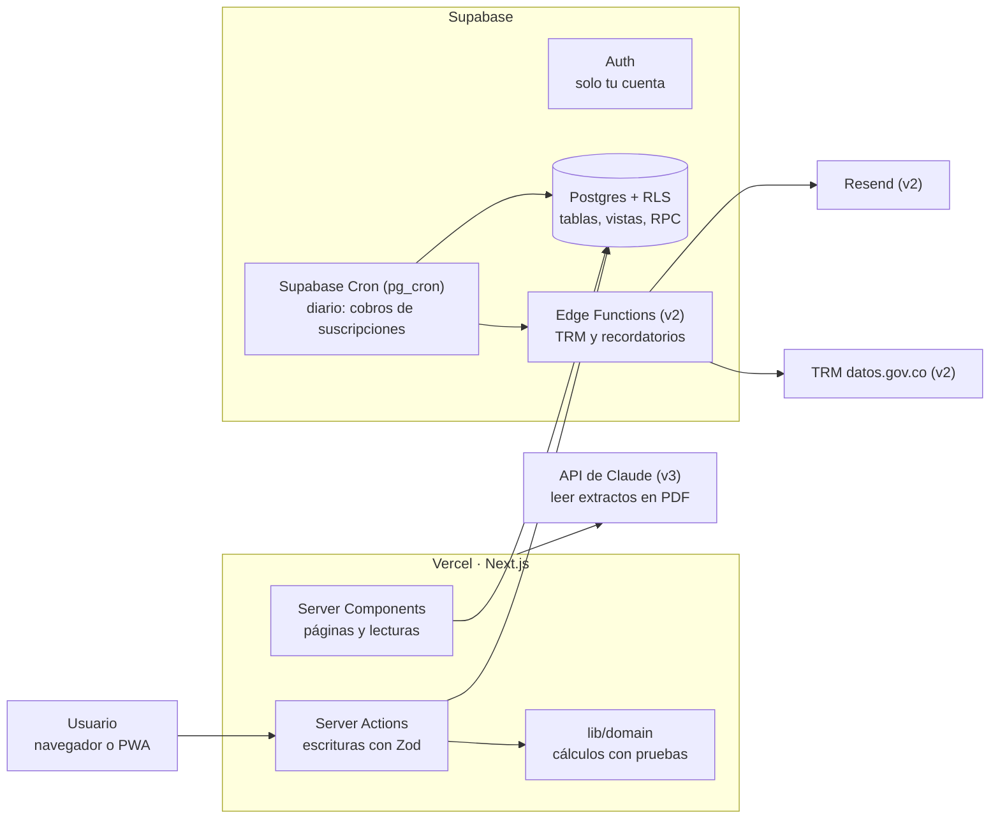

# PRD — App de control de tarjetas de crédito

Versión 1.0 · 5 de noviembre de 2026

## 1. Resumen y objetivos

La app es un tablero personal para controlar tarjetas de crédito: registra cada movimiento, lo asigna al extracto correcto y muestra cuánto se pagará en cada corte y cuánto queda comprometido a futuro.

**Problema.** El banco muestra el extracto mes a mes, pero no la foto completa: cuotas pendientes de varias compras, suscripciones repartidas entre tarjetas, avances con comisiones y cobros en dólares que cambian con la TRM. Eso hace difícil saber cuánto se debe de verdad y cuánto se puede gastar.

**Objetivos**

1. Saber, para cada tarjeta, cuánto se pagará en el próximo extracto y por qué conceptos.
2. Ver la deuda total pendiente y los compromisos de los próximos 12 meses.
3. Controlar las suscripciones recurrentes y evitar cobros olvidados.
4. Mantener un historial mensual de gastos por tarjeta y categoría.

**Métricas de éxito**

- El extracto proyectado difiere del extracto real del banco en menos del 1% durante 3 cortes seguidos.
- Registrar un gasto desde el celular toma menos de 15 segundos.
- Ningún cobro de suscripción aparece en el extracto sin estar registrado en la app.

## 2. Usuario y alcance

La app tiene un solo usuario: el dueño, en Colombia, con varias tarjetas de crédito en pesos y algunos cobros en dólares. Se usa desde el computador para revisar y desde el celular para registrar gastos.

**Decisiones por ser de uso personal**

- Hay autenticación (Supabase Auth con email y contraseña o magic link), pero el registro público queda desactivado. Solo existe la cuenta del dueño.
- Las tablas igual llevan `user_id` y políticas RLS. Cuesta poco, protege los datos si la clave pública de Supabase se filtra y deja la puerta abierta a más usuarios en el futuro.
- No hay onboarding, planes, pagos ni panel de administración.
- Moneda base COP; moneda secundaria USD. Zona horaria fija `America/Bogota`.

**No-objetivos**

- Conectarse directamente a los bancos (open banking). En Colombia no hay una API pública práctica para uso personal.
- Manejar cuentas de ahorro, inversiones o créditos que no sean tarjetas.
- Hacer pagos desde la app.

## 3. Glosario de dominio

Estos términos se usan con el mismo significado en el código, la base de datos y la interfaz.

| Término | En el código | Definición |
| --- | --- | --- |
| Tarjeta | `card` | Tarjeta de crédito con cupo, día de corte, día de pago, tasa y cuota de manejo. |
| Día de corte | `cutoff_day` | Día del mes en que el banco cierra el periodo. Lo comprado después del corte va al siguiente extracto. |
| Día de pago | `payment_day` | Día límite para pagar el extracto, normalmente 10 a 20 días después del corte. |
| Extracto | `statement` | Un periodo de facturación de una tarjeta: fecha de inicio, fecha de corte, fecha límite de pago y total. |
| Movimiento | `transaction` | Cualquier cargo o abono: compra, avance, pago, cuota de manejo, interés, seguro o ajuste. |
| Compra a cuotas | `transaction` + `installments` | Compra diferida a N cuotas. Cada cuota cae en un extracto distinto y puede llevar interés. |
| Cuota | `installment` | Una fracción de una compra a cuotas: número, capital, interés, saldo restante y extracto asignado. |
| Avance | `transaction` tipo `cash_advance` | Retiro de efectivo con la tarjeta. Suele tener comisión fija y una tasa distinta a la de compras. |
| Suscripción | `subscription` | Cobro recurrente (mensual o anual) asociado a una tarjeta, en COP o USD. |
| Tasa E.A. | `annual_rate_ea` | Tasa efectiva anual que publica el banco. Se convierte a mensual para calcular cuotas. |
| TRM | `fx_rate` | Tasa Representativa del Mercado del día, usada para estimar cobros en dólares. |
| Cupo disponible | calculado | Cupo total menos el saldo de capital pendiente de la tarjeta. |

## 4. Funcionalidades por fase

El MVP cubre registrar movimientos y ver el extracto proyectado de cada tarjeta; v2 agrega planeación y alertas; v3 automatiza la captura de datos. Cada fase se considera terminada cuando cumple todos sus criterios de aceptación.

### MVP

**F1. Tarjetas.** Como dueño, quiero registrar mis tarjetas con sus condiciones para que la app calcule extractos e intereses.

- Campos: nombre, banco, franquicia, últimos 4 dígitos, cupo total, día de corte, día de pago, tasa E.A. de compras, tasa E.A. de avances, comisión por avance, cuota de manejo mensual, método de amortización, color.
- Se puede archivar una tarjeta sin borrar su historial.
- Cambiar la tasa no recalcula cuotas ya generadas; solo aplica a compras nuevas.

**F2. Movimientos.** Como dueño, quiero registrar cualquier cargo o abono en menos de 15 segundos.

- Tipos: compra, avance, pago, cuota de manejo, interés, seguro, devolución y ajuste.
- Campos: tarjeta, fecha, valor, moneda, comercio, categoría, número de cuotas (1 por defecto), nota.
- El movimiento se asigna automáticamente al extracto según la fecha y el día de corte (regla R1).
- Se puede editar y eliminar; si tiene cuotas, se regeneran.

**F3. Compras a cuotas.** Como dueño, quiero ver cuántas cuotas me faltan y cuánto debo de cada compra diferida.

- Al guardar una compra a N cuotas se generan N filas de `installments` con capital, interés, total y extracto asignado.
- La compra muestra su tabla de amortización, la cuota actual (ej. 4/12) y el saldo pendiente.
- Se puede marcar una compra como "sin intereses" (promociones de cuotas a 0%).

**F4. Suscripciones.** Como dueño, quiero tener mis suscripciones en un solo lugar y que sus cobros aparezcan solos.

- Campos: nombre, tarjeta, categoría, valor, moneda, frecuencia (mensual o anual), día de cobro, fecha de inicio, estado (activa, pausada, cancelada), fecha de fin de prueba gratis.
- Cada día se generan los movimientos de las suscripciones que cobran ese día (tarea programada).
- La vista muestra el costo mensual total y el anual equivalente.

**F5. Extractos.** Como dueño, quiero saber cuánto voy a pagar en el próximo corte de cada tarjeta.

- Cada tarjeta muestra el extracto abierto, el próximo y los anteriores.
- El extracto desglosa: compras de una cuota, cuotas, suscripciones, avances, intereses, cuota de manejo y pagos.
- Se puede registrar el total real del extracto del banco y marcar el extracto como pagado.

**F6. Tablero.** Como dueño, quiero ver en una pantalla el estado de todas mis tarjetas.

- Por tarjeta: próximo pago y fecha límite, cupo disponible, % de utilización.
- Totales: deuda total pendiente, total a pagar este mes, gasto del mes actual frente al anterior.

**F7. Historial.** Como dueño, quiero consultar mis gastos mes a mes.

- Lista filtrable por mes, tarjeta, categoría, tipo y texto del comercio.
- Gráfico de gasto mensual de los últimos 12 meses y gasto por categoría del mes elegido.

**F8. Categorías.** Lista editable con categorías iniciales: mercado, restaurantes, transporte, servicios, salud, entretenimiento, suscripciones, viajes, educación, hogar, otros.

### v2 — planeación y alertas

- **Compromisos futuros:** gráfico de los próximos 12 meses con lo ya comprometido por cuotas y suscripciones, por tarjeta.
- **Cobros en USD:** el movimiento guarda el valor en USD, la TRM usada y el valor en COP. Las suscripciones en USD se estiman con la TRM del día y luego se corrigen con el valor real del extracto.
- **Recordatorios por email:** 3 días antes de la fecha límite de pago, 2 días antes de que termine una prueba gratis y 7 días antes de una renovación anual.
- **Detección de alzas:** aviso cuando el cobro real de una suscripción supera en más del 5% al anterior.
- **Conciliación:** casilla "verificado" por movimiento y comparación del total calculado contra el total real del extracto, con la diferencia resaltada.
- **Presupuestos por categoría:** límite mensual con alertas al 80% y al 100%.
- **Intereses pagados:** total de intereses, comisiones y cuotas de manejo del año en curso.
- **Simulador de abono a capital:** dado un abono, muestra el ahorro en intereses al reducir plazo frente a reducir cuota.
- **Costo del pago mínimo:** cuánto tiempo e intereses tomaría pagar la deuda pagando solo el mínimo.
- **PWA:** instalable en el celular con un formulario de registro rápido.
- **Exportar a CSV** cualquier vista filtrada del historial.

### v3 — captura automática

- **Importar extracto en PDF:** se sube el PDF del banco, un modelo de lenguaje (API de Claude) extrae los movimientos y el usuario confirma o corrige cada uno antes de guardarlos. Se detectan duplicados por fecha, valor y comercio.
- **Captura desde email:** el usuario reenvía la notificación de compra del banco a una dirección de entrada y la app crea un movimiento en estado "por confirmar".
- **Gastos compartidos:** marcar qué parte de un gasto le corresponde a otra persona y llevar el saldo que le deben.
- **Estrategia de pago:** recomendación de qué tarjeta pagar primero con un monto disponible (método avalancha o bola de nieve).

## 5. Reglas de negocio y cálculos

Toda la lógica de esta sección vive en funciones puras de TypeScript (`lib/domain/`) con pruebas unitarias. Son la parte más propensa a errores y la que más vale la pena probar.

### R1. Asignación al extracto

- La fecha de corte de un mes es el `cutoff_day` de ese mes; si el mes no tiene ese día (ej. 31 en febrero), es el último día del mes.
- Un movimiento con fecha `d` pertenece al extracto cuya fecha de corte es la primera mayor o igual a `d`. Ejemplo con corte el 15: una compra del 15 de marzo va al extracto de marzo; una del 16 de marzo va al de abril.
- La fecha límite de pago es el primer `payment_day` posterior a la fecha de corte, con el mismo ajuste de fin de mes.
- Todas las fechas se interpretan en `America/Bogota`. Una fecha se guarda como `date` (sin hora) para evitar saltos de día por UTC.

### R2. Cuotas

La tasa mensual se obtiene de la tasa efectiva anual del banco:

```
i = (1 + EA)^(1/12) − 1
```

Cada tarjeta define su método de amortización, porque los bancos lo calculan distinto:

- **Capital fijo** (`fixed_principal`, valor por defecto, común en tarjetas en Colombia): cada cuota abona P/N a capital y paga interés sobre el saldo, así que las cuotas van bajando.
- **Cuota fija** (`french`, sistema francés): todas las cuotas tienen el mismo valor.

```
Capital fijo:  C_k = P/N + S_(k−1) · i
Cuota fija:    C   = P · i / (1 − (1 + i)^(−N))
```

Donde P es el valor de la compra, N el número de cuotas y S el saldo de capital antes de la cuota k.

- La cuota k se asigna al extracto de la compra más k − 1 meses.
- Los valores en COP se redondean a pesos enteros; la última cuota absorbe la diferencia de redondeo para que el capital sume exactamente P.
- Una compra a 1 cuota no genera intereses. Una compra marcada "sin intereses" usa i = 0.
- La tasa queda congelada en la compra. Si el banco cobra otro valor, la diferencia se registra con un movimiento de tipo "ajuste" durante la conciliación.

### R3. Avances

Un avance genera dos movimientos: el avance (con cuotas, usando la tasa de avances) y la comisión por avance, en la misma fecha y extracto.

### R4. Suscripciones

- La próxima fecha de cobro se calcula desde la fecha de inicio y la frecuencia. Si el día de cobro no existe en el mes, se usa el último día.
- La generación de cobros es idempotente: una restricción única sobre (`subscription_id`, `date`) impide duplicados aunque la tarea se ejecute dos veces.
- Una suscripción pausada o cancelada no genera cobros.

### R5. Totales

- Total del extracto = compras de 1 cuota + cuotas asignadas + cobros de suscripciones + avances y comisiones + intereses + cuotas de manejo + seguros − devoluciones. Los pagos se muestran aparte como abonos.
- Cupo disponible = cupo total − (capital pendiente de todos los cargos − pagos y devoluciones).
- Utilización = (cupo total − cupo disponible) / cupo total.

### R6. Moneda

- Cada movimiento guarda `amount` y `currency` originales; si es USD, también `fx_rate` y `amount_cop`.
- En el MVP la TRM se ingresa a mano o se precarga con la última conocida; en v2 se consulta automáticamente una vez al día.

## 6. Modelo de datos

Ocho tablas en Postgres (Supabase), todas con `id uuid`, `user_id`, `created_at` y políticas RLS `user_id = auth.uid()`. Los montos son `numeric(14,2)`, nunca `float`; las fechas de negocio son `date`.

| Tabla | Campos principales | Notas |
| --- | --- | --- |
| `cards` | name, bank, network, last4, credit_limit, cutoff_day, payment_day, purchase_rate_ea, advance_rate_ea, advance_fee, handling_fee, amortization_method, color, archived_at | `amortization_method`: `fixed_principal` o `french`. |
| `statements` | card_id, period_start, cutoff_date, due_date, real_total, paid_at | Único por (card_id, cutoff_date). Se crea al primer movimiento que cae en ese periodo. |
| `categories` | name, icon, color, monthly_budget | `monthly_budget` se usa en v2. |
| `transactions` | card_id, statement_id, category_id, type, date, merchant, amount, currency, fx_rate, amount_cop, installments_count, interest_free, rate_ea_applied, subscription_id, parent_id, source, verified, note | `type`: purchase, cash_advance, advance_fee, payment, handling_fee, interest, insurance, refund, adjustment. `source`: manual, subscription, import, email. `parent_id` une la comisión con su avance. |
| `installments` | transaction_id, statement_id, number, principal, interest, total, balance_after | Se borran y regeneran si cambia la compra. |
| `subscriptions` | card_id, category_id, name, amount, currency, frequency, billing_day, start_date, trial_ends_at, status, last_charged_amount | `status`: active, paused, cancelled. |
| `fx_rates` | date, usd_cop | Una fila por día. Sin `user_id`; lectura para cualquier usuario autenticado. |
| `notification_log` | kind, ref_id, scheduled_for, sent_at | Evita enviar el mismo recordatorio dos veces (v2). |

**Índices y restricciones clave**

- Único parcial en `transactions (subscription_id, date) where subscription_id is not null` para que los cobros automáticos sean idempotentes.
- Índices en `transactions (card_id, date)`, `transactions (statement_id)` e `installments (statement_id)`.
- `cutoff_day` y `payment_day` con `check` entre 1 y 31.

**Vistas**

- `statement_totals`: total calculado por extracto y por concepto, uniendo movimientos de 1 cuota e `installments`.
- `card_balances`: capital pendiente, cupo disponible y utilización por tarjeta.

Las migraciones se manejan con el CLI de Supabase (`supabase/migrations`) y los tipos de TypeScript se generan con `supabase gen types`.

## 7. Stack y arquitectura

La app usa Next.js en Vercel con Supabase como base de datos, autenticación y tareas programadas. Se eligió Next.js sobre una SPA con Vite porque trae integración oficial con Supabase Auth, permite rutas de servidor para la importación de PDFs (v3) sin piezas adicionales y es un framework muy conocido por los agentes de código, lo que reduce errores de implementación.

| Capa | Elección | Motivo |
| --- | --- | --- |
| Framework | Next.js (App Router) + TypeScript | Server Components para leer, Server Actions para escribir, un solo despliegue. |
| Interfaz | Tailwind CSS + shadcn/ui | Componentes accesibles que viven en el repo y se pueden editar. |
| Formularios | React Hook Form + Zod | La misma validación en cliente y servidor. |
| Gráficos | Recharts | Suficiente para barras, líneas y tortas del tablero. |
| Base de datos y auth | Supabase (Postgres, Auth, RLS) | Postgres real, migraciones con CLI y tipos generados. |
| Tareas programadas | Supabase Cron + Edge Functions | Corren junto a los datos, sin depender del hosting. |
| Dinero y fechas | decimal.js, date-fns + date-fns-tz | Aritmética exacta y zona horaria fija. |
| Pruebas | Vitest | Pruebas rápidas de `lib/domain/`. |
| Email (v2) | Resend | Envío simple desde Edge Functions. |
| IA (v3) | API de Claude | Extraer movimientos de extractos en PDF. |
| Hosting | Vercel (plan Hobby) | Despliegue automático en cada push. |



Todo lo que escribe datos pasa por Server Actions, que usan `lib/domain` para calcular extractos y cuotas antes de guardar. Las tareas diarias no dependen de Vercel: Supabase Cron ejecuta funciones SQL y, desde v2, llama Edge Functions para la TRM y los correos.

## 8. Pantallas y flujos

El MVP tiene ocho pantallas. El diseño es mobile-first, con navegación inferior en el celular y lateral en el computador, y soporta modo claro y oscuro.

| Ruta | Pantalla | Contenido |
| --- | --- | --- |
| `/` | Tablero | Tarjeta por tarjeta: próximo pago, fecha límite, cupo disponible y utilización. Totales del mes y botón flotante "Nuevo gasto". |
| `/movimientos` | Historial | Lista agrupada por día con filtros (mes, tarjeta, categoría, tipo, texto) y gráficos del mes. |
| `/movimientos/nuevo` | Registro rápido | Valor, tarjeta (la última usada por defecto), categoría, comercio, cuotas. Fecha de hoy por defecto. |
| `/movimientos/[id]` | Detalle | Datos del movimiento y, si tiene cuotas, su tabla de amortización. |
| `/tarjetas/[id]` | Detalle de tarjeta | Extracto abierto, próximos y anteriores; compras a cuotas activas con su avance (ej. 4/12). |
| `/tarjetas/[id]/extractos/[cutoff]` | Extracto | Desglose por concepto, total calculado frente al real, marcar como pagado. |
| `/suscripciones` | Suscripciones | Lista con próximo cobro, costo mensual y anual total, pruebas por vencer. |
| `/ajustes` | Ajustes | Tarjetas, categorías, preferencias y exportación de datos. |

**Flujo principal: registrar una compra a cuotas**

1. Desde el tablero, el usuario toca "Nuevo gasto".
2. Escribe el valor, elige tarjeta y categoría, y cambia cuotas de 1 a 6.
3. Antes de guardar, el formulario muestra la vista previa: valor de la primera cuota, total de intereses y extracto donde cae la primera cuota.
4. Al guardar, se crean el movimiento y sus 6 cuotas en una sola transacción de base de datos.
5. El tablero se actualiza con el nuevo próximo pago y cupo disponible.

## 9. Tareas programadas y notificaciones

Las tareas corren con Supabase Cron (`pg_cron`), dentro de la base de datos, para no depender del hosting del frontend. `pg_cron` usa UTC: las 5:00 a. m. en Bogotá son las 10:00 UTC.

| Tarea | Horario (Bogotá) | Qué hace | Implementación | Fase |
| --- | --- | --- | --- | --- |
| Cobros de suscripciones | Diario, 5:00 a. m. | Crea los movimientos de las suscripciones activas que cobran hoy, con su extracto asignado. | Función SQL `generate_subscription_charges()` | MVP |
| TRM del día | Diario, 6:00 a. m. | Guarda la TRM oficial en `fx_rates` (fuente: datos abiertos de la Superfinanciera en datos.gov.co, por confirmar). | Edge Function | v2 |
| Recordatorios | Diario, 7:00 a. m. | Envía un email por cada pago próximo, prueba gratis por vencer o renovación anual. Registra cada envío en `notification_log`. | Edge Function + Resend | v2 |
| Alertas de presupuesto | Al guardar un movimiento | Revisa si la categoría pasó el 80% o el 100% del presupuesto del mes. | Server Action | v2 |

**Reglas**

- Toda tarea es idempotente: correrla dos veces el mismo día no duplica datos ni correos.
- Si una ejecución falla, la siguiente recupera lo pendiente: la tarea de suscripciones genera los cobros de los últimos 7 días que falten, no solo los de hoy.
- Alternativa si se prefiere todo en Vercel: Vercel Cron en el plan Hobby alcanza para tareas diarias, pero se dispara en cualquier momento dentro de la hora programada ([fuente](https://vercel.com/docs/cron-jobs/usage-and-pricing)).

## 10. Requisitos no funcionales

**Seguridad y privacidad**

- RLS activado en todas las tablas; ninguna consulta usa la `service_role` key desde el navegador.
- La `service_role` key solo existe en Edge Functions y variables de entorno del servidor.
- No se guarda el número completo de la tarjeta, CVV ni fechas de vencimiento: solo los últimos 4 dígitos.
- Registro público desactivado en Supabase Auth.

**Exactitud del dinero**

- Montos como `numeric` en la base y como `string` o `Decimal` (`decimal.js`) en TypeScript; nunca aritmética con `number` para dinero.
- Formato de presentación con `Intl.NumberFormat('es-CO', { style: 'currency', currency: 'COP' })`.
- Cobertura de pruebas del 100% en `lib/domain/` (extractos, cuotas, suscripciones, totales).

**Fechas**

- Zona horaria única `America/Bogota` en servidor y cliente.
- Pruebas específicas para fin de mes, febrero, años bisiestos y compras hechas exactamente el día de corte.

**Rendimiento y uso**

- El tablero carga en menos de 1,5 s en 4G.
- Funciona bien en pantallas desde 360 px de ancho.
- Textos de la interfaz en español de Colombia.

**Respaldo**

- Exportación completa de los datos a CSV o JSON desde Ajustes, además de los respaldos automáticos de Supabase según el plan.

## 11. Plan de implementación

El MVP se construye en 9 hitos, uno por sesión de trabajo con el agente de código. La lógica de dominio va antes que la interfaz: así hay pruebas que confirman que los cálculos están bien antes de construir pantallas encima.

1. **H0. Base del proyecto.** Next.js + TypeScript + Tailwind + shadcn/ui, proyecto en Supabase, CLI enlazado, login con Supabase Auth, despliegue en Vercel. Listo cuando el login funciona en producción.
2. **H1. Dominio puro.** Funciones de R1 a R5 en `lib/domain/` con pruebas en Vitest. Listo cuando todas las pruebas pasan, incluidos los casos de fin de mes.
3. **H2. Base de datos.** Migraciones de las 8 tablas, RLS, índices, vistas y tipos generados. Listo cuando una prueba con un segundo usuario no puede leer datos ajenos.
4. **H3. Tarjetas y categorías.** CRUD completo con validación Zod.
5. **H4. Movimientos y cuotas.** Registro rápido, vista previa de cuotas y guardado transaccional (función RPC en Postgres).
6. **H5. Extractos.** Detalle de tarjeta y de extracto, total real y marcado como pagado.
7. **H6. Suscripciones.** CRUD y la tarea diaria de cobros con `pg_cron`.
8. **H7. Tablero e historial.** Indicadores, filtros y gráficos.
9. **H8. Pulido.** Diseño responsive, estados vacíos, modo oscuro y exportación de datos.

**Cómo trabajar cada hito**

- Este PRD vive en `docs/PRD.md` y las instrucciones para el agente en `AGENTS.md`, en la raíz del repo.
- Empezar cada sesión con: "Lee docs/PRD.md y AGENTS.md, y propón un plan para el hito HN antes de escribir código".
- Revisar el plan propuesto y solo entonces aprobar la implementación.
- Si el agente soporta MCP, conectar el servidor MCP de Supabase para que consulte el esquema y aplique migraciones en desarrollo.
- Hacer un commit al cerrar cada hito, con las pruebas en verde.

## 12. Riesgos y preguntas abiertas

El mayor riesgo es que los cálculos no coincidan con los del banco; la conciliación (v2) y las pruebas del dominio existen para detectarlo pronto.

**Riesgos**

| Riesgo | Mitigación |
| --- | --- |
| Cada banco calcula intereses de forma distinta (interés proporcional de la primera cuota, redondeos). | Método de amortización por tarjeta y movimientos de ajuste en la conciliación. |
| La tasa de las tarjetas cambia cada mes. | La tasa se congela por compra; las diferencias se ajustan contra el extracto real. |
| Registrar a mano es tedioso y se abandona. | Registro rápido en el MVP; importación de PDF y captura por email en v3. |
| Errores de fecha por zona horaria. | Tipo `date`, zona fija y pruebas de casos límite. |

**Preguntas abiertas**

- [ ] ¿Alguna tarjeta tiene corte variable (por ejemplo, "último día hábil") en lugar de un día fijo?
- [ ] ¿Los bancos amortizan las compras con capital fijo o con cuota fija? Se puede confirmar con la tabla de un extracto real.
- [x] Tratamiento de USD en la app: se amortiza en USD y se guarda el equivalente estimado en COP con la TRM de la compra (D3). La forma de facturación de cada banco se confirma con su extracto real.
- [x] Cambio de día de corte: solo afecta movimientos nuevos; no recalcula extractos existentes y la interfaz lo advierte (D10).
- [ ] ¿Los recordatorios bastan por email o se quieren notificaciones push en el celular?

**Fuera de alcance**

Múltiples usuarios, conexión directa con bancos, cuentas de ahorro, inversiones, créditos distintos a tarjetas y pagos desde la app.

### Decisiones aprobadas durante la implementación

Este registro consolida las decisiones del dueño de `plans/README.md`; no agrega alcance ni sustituye la comprobación contra extractos bancarios. D1–D10, D15 y D16 fueron aprobadas el 9 de noviembre de 2026; D11–D13 el 10 y D14 el 11.

| Decisión | Regla vigente del MVP |
| --- | --- |
| D1 · Cuota de manejo | Se genera al crear el extracto, con fecha de corte, si es mayor que cero. Cargo `system` e índice único por extracto para evitar duplicados. |
| D2 · Cupo | Usado = capital completo de cargos + intereses de cuotas ya facturadas − pagos − devoluciones. Disponible = cupo − usado. |
| D3 · USD | Cuotas en USD con redondeo a centavos; cada cuota guarda equivalentes COP con la TRM de la compra. La última absorbe las diferencias de capital en ambas monedas. |
| D4 · TRM | La última de `fx_rates`; si no existe, la del último movimiento USD del mismo usuario. El cron omite el cobro si falta TRM y lo recupera dentro de su ventana de siete días. |
| D5 · Gasto mensual | Compras por su valor completo, avances y suscripciones del mes calendario en Bogotá, menos devoluciones. Excluye pagos, intereses, comisiones, manejo y seguros. |
| D6 · Edición | Se permite editar compras con cuotas en extractos pagados y se regeneran todas las cuotas; la interfaz advierte antes de guardar. |
| D7 · Vencimiento | La fecha de pago debe ser estrictamente posterior al corte; si no lo es en el mismo mes, pasa al siguiente. |
| D8 · Avance a una cuota | No genera intereses; su comisión se registra por separado. |
| D9 · Categorías | Trigger al crear el usuario con las once categorías iniciales; migración idempotente para usuarios existentes. |
| D10 · Cambio de corte | Solo afecta movimientos nuevos. Los extractos existentes se conservan. |
| D11 · Categorías sin color | Icono Lucide y nombre; `color` queda en `null`. El gráfico mensual conserva los colores de tarjeta; el gráfico por categoría se actualiza por D17. |
| D12 · Campos | Token de borde `--input` con contraste mínimo 3:1 y estilo `text-input` de 16 px para evitar zoom automático en iOS. |
| D13 · Pesos | Se elimina el espacio entre `$` y la cifra; USD conserva `US$ 15,99`. |
| D14 · Favicon | Cuadrado neutro temporal con el token primario, sin letras ni símbolos; no constituye un logo. |
| D15 · Cuotas máximas | Entre una y 36 cuotas en compras y avances. |
| D16 · Ajustes | `adjustment` siempre es cargo; las correcciones a favor se registran como `refund`. |
| D17 · Gráfico por categoría | Por petición del dueño del 13 de noviembre, usa colores de `chart-1` a `chart-5`, siempre junto al nombre y al valor. Es presentación del historial: `categories.color` sigue en `null` y no se agregan colores a los formularios ni a la lista de movimientos. Sustituye el gráfico neutro de D11. |

Precisiones posteriores aprobadas: al editar una compra se conserva la tasa original si no cambian tarjeta ni tipo (10 de noviembre); guardar una suscripción intenta generar su cobro de hoy sin esperar al cron (10 de noviembre); el tablero prioriza el extracto no pagado con vencimiento más antiguo, incluso vencido (11 de noviembre).
