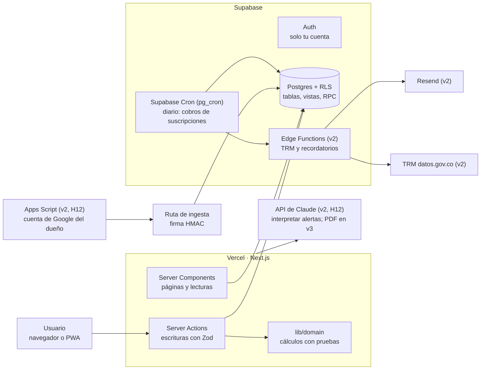

# PRD — App de control de tarjetas de crédito

Versión 1.2 · 17 de noviembre de 2026 · H10 y H12 aprobados, pendientes de implementación

## 1. Resumen y objetivos

La app es una herramienta personal para controlar tarjetas de crédito: registra cada movimiento, lo asigna al extracto correcto y organiza la información por **mes de pago**, para mostrar cuánto se paga este mes, el historial de meses anteriores y lo ya comprometido en los meses futuros.

**Problema.** El banco muestra el extracto mes a mes, pero no la foto completa: cuotas pendientes de varias compras, suscripciones repartidas entre tarjetas, avances con comisiones y cobros en dólares que cambian con la TRM. Eso hace difícil saber cuánto se debe de verdad y cuánto se puede gastar.

**Objetivos**

1. Saber, para cada tarjeta, cuánto se pagará en el próximo extracto y por qué conceptos.
2. Ver la deuda total pendiente y los compromisos de los próximos 12 meses.
3. Controlar las suscripciones recurrentes y evitar cobros olvidados.
4. Mantener un historial mensual de gastos por tarjeta y categoría.

**Métricas de éxito**

- El extracto proyectado difiere del extracto real del banco en menos del 1% durante 3 cortes seguidos.
- Registrar un gasto desde el celular toma menos de 15 segundos.
- Ningún cobro de suscripción aparece en el extracto sin estar registrado en la app.

## 2. Usuario y alcance

La app tiene un solo usuario: el dueño, en Colombia, con varias tarjetas de crédito en pesos y algunos cobros en dólares. Se usa desde el computador para revisar y desde el celular para registrar gastos.

**Decisiones por ser de uso personal**

- Hay autenticación (Supabase Auth con email y contraseña o magic link), pero el registro público queda desactivado. Solo existe la cuenta del dueño.
- Las tablas igual llevan `user_id` y políticas RLS. Cuesta poco, protege los datos si la clave pública de Supabase se filtra y deja la puerta abierta a más usuarios en el futuro.
- No hay onboarding, planes, pagos ni panel de administración.
- Moneda base COP; moneda secundaria USD. Zona horaria fija `America/Bogota`.

**No-objetivos**

- Conectarse directamente a los bancos (open banking). En Colombia no hay una API pública práctica para uso personal.
- Manejar cuentas de ahorro, inversiones o créditos que no sean tarjetas.
- Hacer pagos desde la app.

## 3. Glosario de dominio

Estos términos se usan con el mismo significado en el código, la base de datos y la interfaz.

| Término | En el código | Definición |
| --- | --- | --- |
| Tarjeta | `card` | Tarjeta de crédito con cupo, día de corte, día de pago, tasa y cuota de manejo. |
| Día de corte | `cutoff_day` | Día del mes en que el banco cierra el periodo. Lo comprado después del corte va al siguiente extracto. |
| Día de pago | `payment_day` | Día límite para pagar el extracto, normalmente 10 a 20 días después del corte. |
| Extracto | `statement` | Un periodo de facturación de una tarjeta: fecha de inicio, fecha de corte, fecha límite de pago y total. |
| Movimiento | `transaction` | Cualquier cargo o abono: compra, avance, pago, cuota de manejo, interés, seguro o ajuste. |
| Compra a cuotas | `transaction` + `installments` | Compra diferida a N cuotas. Cada cuota cae en un extracto distinto y puede llevar interés. |
| Cuota | `installment` | Una fracción de una compra a cuotas: número, capital, interés, saldo restante y extracto asignado. |
| Avance | `transaction` tipo `cash_advance` | Retiro de efectivo con la tarjeta. Suele tener comisión fija y una tasa distinta a la de compras. |
| Suscripción | `subscription` | Cobro recurrente (mensual o anual) asociado a una tarjeta, en COP o USD. |
| Tasa E.A. | `annual_rate_ea` | Tasa efectiva anual que publica el banco. Se convierte a mensual para calcular cuotas. |
| TRM | `fx_rate` | Tasa Representativa del Mercado del día, usada para estimar cobros en dólares. |
| Cupo disponible | calculado | Cupo total menos el saldo de capital pendiente de la tarjeta. |

## 4. Funcionalidades por fase

El MVP cubre registrar movimientos y ver el extracto proyectado de cada tarjeta; v2 agrega planeación y alertas; v3 automatiza la captura de datos. Cada fase se considera terminada cuando cumple todos sus criterios de aceptación.

### MVP

**F1. Tarjetas.** Como dueño, quiero registrar mis tarjetas con sus condiciones para que la app calcule extractos e intereses.

- Campos: nombre, banco, franquicia, últimos 4 dígitos, cupo total, día de corte, día de pago, tasa E.A. de compras, tasa E.A. de avances, comisión por avance, cuota de manejo mensual, método de amortización, color.
- Se puede archivar una tarjeta sin borrar su historial.
- Cambiar la tasa no recalcula cuotas ya generadas; solo aplica a compras nuevas.

**F2. Movimientos.** Como dueño, quiero registrar cualquier cargo o abono en menos de 15 segundos.

- Tipos: compra, avance, pago, cuota de manejo, interés, seguro, devolución y ajuste.
- Campos: tarjeta, fecha, valor, moneda, comercio, categoría, número de cuotas (1 por defecto), nota.
- El movimiento se asigna automáticamente al extracto según la fecha y el día de corte (regla R1).
- Se puede editar y eliminar; si tiene cuotas, se regeneran.

**F3. Compras a cuotas.** Como dueño, quiero ver cuántas cuotas me faltan y cuánto debo de cada compra diferida.

- Al guardar una compra a N cuotas se generan N filas de `installments` con capital, interés, total y extracto asignado.
- La compra muestra su tabla de amortización, la cuota actual (ej. 4/12) y el saldo pendiente.
- Se puede marcar una compra como "sin intereses" (promociones de cuotas a 0%).

**F4. Suscripciones.** Como dueño, quiero tener mis suscripciones en un solo lugar y que sus cobros aparezcan solos.

- Campos: nombre, tarjeta, categoría, valor, moneda, frecuencia (mensual o anual), día de cobro, fecha de inicio, estado (activa, pausada, cancelada), fecha de fin de prueba gratis.
- Cada día se generan los movimientos de las suscripciones que cobran ese día (tarea programada).
- La vista muestra el costo mensual total y el anual equivalente.

**F5. Extractos.** Como dueño, quiero saber cuánto voy a pagar en el próximo corte de cada tarjeta.

- Cada tarjeta muestra el extracto abierto, el próximo y los anteriores.
- El extracto desglosa: compras de una cuota, cuotas, suscripciones, avances, intereses, cuota de manejo y pagos.
- Se puede registrar el total real del extracto del banco y marcar el extracto como pagado.
- Registrar un abono y marcar un extracto como pagado son acciones independientes. Marcar pagado no crea un movimiento de pago ni libera cupo; el total bancario es una referencia y no sustituye el calculado (D26, D27).

**F6. Meses (pantalla de inicio).** Como dueño, quiero ver apenas entro la lista de meses con un resumen de cada uno, para saber cuánto pago este mes, revisar los anteriores y anticipar los próximos. Sustituye al tablero original (D25).

- Los meses se organizan por **mes de pago**: un extracto pertenece al mes de su fecha límite (R7, D18).
- Orden: el mes actual arriba y destacado; luego "Próximos meses" en orden ascendente; luego "Meses anteriores" en orden descendente (D22).
- Cada fila muestra el nombre del mes, el total del mes, el importe **"Pendiente de confirmar pago"** si es distinto del total, una barra apilada con el color de cada tarjeta y el estado del mes (D19, D26). El pendiente es un control por extracto, no un saldo después de abonos; las proyecciones se identifican aparte según R7.
- El mes actual incluye cobros previstos en sus extractos aún abiertos. Los meses futuros muestran solo lo comprometido y se marcan como **Estimado** (D20). El rango futuro cubre los compromisos conocidos dentro de los siguientes 12 meses, incluida la cuota de manejo aunque no haya cuotas ni suscripciones; los pasados muestran todo el historial, de 12 meses con datos en 12 (D21).
- Si hay extractos vencidos de meses anteriores, una alerta arriba de la lista muestra el total calculado de los extractos vencidos sin confirmar pago y ofrece acceso a cada mes afectado (D23, D26).
- Una franja compacta muestra cada tarjeta activa con su cupo disponible y utilización, y enlaza a `/tarjetas/[id]` (D25). La deuda total registrada se conserva como dato secundario, sin sumar proyecciones ni limitarse a los próximos 12 meses.
- El mes actual siempre se muestra; si no tiene extractos ni compromisos previstos indica "Sin extractos", sin aparentar que está pagado. Archivar todas las tarjetas no oculta el historial ni los compromisos reales.
- Toda la fila del mes enlaza a su detalle.

**F7. Historial.** Como dueño, quiero consultar mis gastos mes a mes.

- Lista filtrable por mes de compra (fecha del movimiento, D5), tarjeta, categoría, tipo y texto del comercio. La etiqueta del filtro explicita ese criterio; no se reutiliza para filtrar cuotas por mes de pago.
- La lista con filtros es el contenido principal. El gráfico por categoría se muestra en el detalle de cada mes (F9) y la evolución mensual la cubre la lista de meses (F6), así que esta vista no repite gráficos (D25).

**F8. Categorías.** Lista editable con categorías iniciales: mercado, restaurantes, transporte, servicios, salud, entretenimiento, suscripciones, viajes, educación, hogar, otros.

**F9. Detalle de un mes.** Como dueño, quiero entrar a un mes y ver cuánto pago por tarjeta y en total, y por qué.

- Encabezado: total calculado del mes, "Pendiente de confirmar pago", estado y comparación con el mes calendario anterior cuando sea comparable (D26, D27, D29).
- Mes actual con extractos aún abiertos: separa "Ya facturado" de "Aún puede crecer"; dentro de este último distingue lo registrado de los cobros recurrentes previstos, indicando qué tarjeta corta y cuándo (D19, D20).
- Un bloque por tarjeta con los extractos del mes: total, fecha límite, estado, periodo de compras que cubre ("compras del 16 sep al 15 oct") y enlace a cada extracto. Conserva las fechas guardadas aunque las condiciones de la tarjeta hayan cambiado. Desde aquí se puede marcar cada extracto real como pagado o deshacer la marca, con acciones secundarias e identificadores accesibles únicos; el total bancario se edita en el extracto.
- Desglose del mes por concepto (compras de 1 cuota, cuotas, suscripciones, avances y comisiones, intereses, cuota de manejo, seguros, ajustes, devoluciones) y por categoría, con el gráfico por categoría (D17, D28). Ambos usan los cargos y cuotas asignados al mes de pago, no el valor completo de las compras del mes calendario.
- Dato secundario, etiquetado por separado: "Compraste en este mes", según D5 (mes de compra), para no confundirlo con lo que se paga.
- Mes futuro: extractos reales más suscripciones y manejo previstos, con la nota "Se sumará lo que gastes antes de cada corte". Las suscripciones en USD se estiman con la última TRM (D4); si falta, se muestra "Total conocido" y una advertencia con los cobros sin convertir. Los extractos virtuales no tienen enlace ni acción de pago.
- Navegación al mes disponible anterior y siguiente. URL `/meses/AAAA-MM`; cargar más historial en la lista no es requisito para acceder directamente a un mes histórico.

### MVP 1.2 — fidelidad con el extracto bancario (H10)

Sale de comparar la app con extractos reales de Bancolombia (noviembre de 2026). El objetivo es que cada extracto de Al Corte cuadre al peso con el del banco: cuotas en curso, intereses, pago mínimo, deuda total y saldo en dólares.

**F10. Compras en curso.** Como dueño, quiero registrar una compra que ya tiene cuotas pagadas antes de usar Al Corte, para ver siempre en qué cuota voy y cuántas faltan.

- El formulario permite indicar "Ya pagué cuotas de esta compra": la cuota (k de N) y, opcionalmente, el saldo pendiente, copiados tal como aparecen en el último extracto del banco. La cuota k es la ya facturada en ese extracto y el saldo es el que queda después de ella (D49).
- La compra conserva su fecha, valor, número de cuotas y tasa originales. Las cuotas anteriores se muestran en su tabla como "Pagada antes de Al Corte", sin extracto, y no cuentan en extractos, meses ni cupo.
- Si el saldo del banco no coincide con el plan (por un abono a capital o un ajuste), se respeta el saldo del banco: misma cuota y menos cuotas restantes (D31).
- En listas y detalles se lee "Cuota 4 de 12".

**F11. Intereses sobre saldo.** Como dueño, quiero que los intereses se calculen como los cobra mi banco, para que el extracto cuadre.

- Cada tarjeta tiene un modo de intereses: por cuota (el actual de R2) o sobre saldo (como Bancolombia, Davivienda y BBVA).
- En modo sobre saldo, las cuotas son solo capital y cada extracto lleva una línea de intereses: la real, si se registró desde el extracto del banco, o una estimada mientras tanto.
- Los meses futuros usan la estimación y la etiquetan como tal.

**F12. Pago mínimo, deuda total y saldos por moneda.** Como dueño, quiero ver cuánto debo pagar este mes y cuánto debo en total, en pesos y en dólares por separado.

- Cada extracto muestra, por moneda: pago mínimo (lo que se paga este mes) y deuda total (todo lo pendiente a la fecha de corte), con los valores reales del banco como referencia.
- El saldo en dólares se paga y se marca como pagado por separado; su equivalente en pesos es solo referencia.
- El mes de pago muestra el pago mínimo como monto principal y la deuda total como dato secundario.

**F13. Suscripciones diferidas y cuotas por defecto en USD.** Como dueño, quiero registrar suscripciones que el banco difiere a cuotas, como las cobradas en dólares.

- Cada tarjeta define a cuántas cuotas difiere por defecto las compras en USD (36 en Bancolombia).
- Una suscripción puede tener número de cuotas; cada cobro automático se registra como compra a esas cuotas.
- La proyección de meses suma la cuota de cada cobro anterior y de cada cobro previsto, no el valor completo.

**F14. Pagos y abonos a capital.** Como dueño, quiero registrar cuánto pagué y ver cómo un abono cambia mis compras, como lo aplica el banco.

- Registrar pago por extracto y moneda: mínimo, total u otro valor. El pago total liquida las cuotas futuras; el excedente sobre el mínimo es un abono a capital.
- Cada tarjeta define cómo se aplican los abonos (prioridad publicada por Bancolombia, compra más antigua o compra elegida) y si reducen el plazo o la cuota.
- Antes de guardar, la app muestra la distribución del abono por compra y permite ajustarla.

**F15. Cierre mensual del extracto.** Como dueño, quiero ingresar en un par de minutos lo que dice el extracto del banco y ver si la app cuadra.

- Pago mínimo, pago total, intereses y tasa vigente por moneda; saldo por compra opcional para corregir cómo aplicó el banco un abono.
- Diferencias visibles solo si superan el redondeo del banco. El extracto queda "Conciliado".

**F16. Cambio de cuotas de una compra.** Como dueño, quiero reflejar cuando cambio en el banco el número de cuotas de una compra.

- Se indica el nuevo número de cuotas restantes (1 a 36) sobre el saldo pendiente, desde la próxima cuota sin facturar. Las cuotas facturadas y las previas se conservan (D40, D50).

**F17. Comisión de avance por movimiento.** La comisión de la tarjeta es solo el valor por defecto; cada avance guarda la suya.

### v2 — planeación y alertas

#### H11 — Registro más rápido y costo real (prioridades 1 a 4)

**Objetivo:** que registrar un movimiento tome segundos y que el dueño vea cuánto le cuesta realmente cada compra, una vez H10 deja los extractos cuadrando con el banco. Agrupa las cuatro funcionalidades que el dueño priorizó sobre el resto de v2 el 16 de noviembre de 2026. La importación mensual (F22) construye además la revisión de movimientos que reutiliza la captura por correo de H12. No usa IA.

**F20. Cuotas y categoría sugeridas por comercio (prioridad 1).** Como dueño, quiero que al escribir el comercio la app me proponga lo que usé la última vez, para registrar en segundos.

- El campo de comercio autocompleta con comercios ya registrados, los más recientes primero.
- Con un comercio conocido se sugieren categoría, número de cuotas, moneda, compra internacional y sin intereses de la última compra con ese comercio en la misma tarjeta; si no hay, en cualquier tarjeta. Aviso: "Como tu última compra en Netflix (7 nov)".
- Las sugerencias solo llenan campos que el dueño no ha tocado y se pueden quitar con un toque. Nunca sugieren valor, fecha ni tarjeta.
- Coincidencia por nombre normalizado (R11), sin coincidencias aproximadas. Los comercios sin historial se resuelven con IA en H12.

**F21. Costo de diferir (prioridad 2).** Como dueño, quiero saber cuánto me cuesta en intereses diferir una compra, antes y después de hacerla.

- Vista previa del formulario: intereses estimados y costo total según cuotas, tasa y modo de la tarjeta. Ejemplo: $9.000 a 36 cuotas con 2,1003 % M.V. en capital fijo ≈ $3.308 de intereses y $12.308 en total en una tarjeta con intereses sobre saldo, como las de Bancolombia; ≈ $3.497 y $12.497 con intereses por cuota.
- Alerta cuando los intereses estimados superan el 20 % del valor de la compra.
- Detalle de la compra: intereses ya causados y estimados por pagar. Con intereses sobre saldo el banco no los reparte por compra, así que ambas cifras son estimadas.
- Extracto y mes: ahorro estimado en intereses si se paga la deuda total de esa moneda en lugar del mínimo.
- Todo valor calculado sobre el futuro lleva la etiqueta "estimado".

**F22. Importación mensual de extractos (prioridad 3).** Como dueño, quiero cargar el extracto de cada mes desde un archivo para completar lo que no registré a mano.

- Desde Ajustes se sube un archivo `al-corte-import` v1, el formato de la importación de noviembre, documentado en `docs/import-format.md`. El archivo se prepara fuera de la app a partir del PDF del banco; leer el PDF en la app es v3.
- Vista previa antes de guardar: movimientos nuevos, ya registrados y en conflicto, cada uno incluible o excluible. Reconoce como ya registrados los cobros de suscripciones creados por la app, la cuota de manejo y los intereses ya registrados. Los pagos del archivo no se importan: si no están registrados, se ofrecen para registrarlos con el formulario de pago.
- Nunca modifica movimientos existentes. Al marcar un conflicto como "Es el mismo" solo se guarda la referencia del banco en el movimiento, para reconocerlo en los meses siguientes.
- Verificación contra los valores del banco del archivo (pago mínimo, deuda total y cupo) antes y después de guardar, y cierre mensual (F15) prellenado.
- El archivo se procesa en el servidor y no se guarda; solo quedan los movimientos aceptados y los valores del banco del extracto.
- La revisión es un componente reutilizable por la bandeja "Por confirmar" de H12.
- La TRM oficial se carga a diario en `fx_rates` (D57); la importación y el cupo en dólares (F23) la usan.

**F23. Pago del saldo en dólares con pesos (prioridad 4).** Como dueño, quiero registrar cuántos pesos me costó pagar el saldo en dólares y compararlo con lo estimado.

- Al pagar en USD se puede ingresar el valor en pesos debitado; la app deriva la tasa usada por el banco en lugar de pedir la TRM.
- El extracto muestra la diferencia cambiaria: pesos pagados frente al equivalente con la TRM de cada compra.
- Una vez registrado el pago, el mes usa los pesos realmente pagados como equivalente de la parte pagada del saldo en USD; lo que falte por pagar conserva el equivalente de referencia.
- El cupo valora la deuda en dólares con la TRM vigente (D52), no con la de cada compra.

**Terminado cuando:** al recorrer el historial real, la sugerencia acierta categoría y cuotas en al menos el 80 % de las compras con comercio repetido; el costo de diferir coincide con R11 en las pruebas; un extracto mensual se carga desde archivo dos veces sin duplicar y cuadra con el banco; la TRM oficial se carga a diario en `fx_rates`; y un pago en dólares hecho con pesos muestra la tasa derivada y la diferencia cambiaria.

#### H12 — Capa de IA y captura por correo (prioridad 5)

Se implementa después de las cuatro prioridades de v2 (H11) y reutiliza su revisión de importaciones. Sustituye a la "captura desde email" que estaba en v3.

**F18. Captura de movimientos desde el correo.** Como dueño, quiero que las alertas de compra de Bancolombia que llegan a mi correo aparezcan en la app como movimientos por confirmar, para registrar casi sin escribir.

- Un script de Google Apps Script en la cuenta del dueño revisa las alertas cada hora y envía a la app solo la frase del movimiento, firmada.
- Solo se procesan alertas de tarjetas de crédito ("T.Cred *NNNN"). Los movimientos de cuenta de ahorros o tarjeta débito se descartan en el propio script y nunca salen de Google.
- Cada alerta crea un borrador en la bandeja "Por confirmar" con la tarjeta según sus últimos 4 dígitos, y las sugerencias de la IA marcadas como tales. Al confirmar se completan cuotas, categoría y lo que falte.
- Un borrador no afecta extractos, meses, totales ni cupo hasta confirmarse. Si ya existe un movimiento manual igual (tarjeta, valor y fecha), se propone unirlos.
- La captura se puede apagar desde Ajustes. El secreto de firma se puede rotar con un procedimiento documentado: nuevo valor en las variables de entorno de Vercel, nuevo despliegue y actualización en el script (D51).

**F19. Capa de IA.** Base común para funciones de IA (esta captura, la lectura de PDF de v3 y sugerencias para comercios sin historial).

- Tareas con nombre, cada una con esquema de entrada y salida, prompt versionado y modelo configurado. Salidas estructuradas validadas otra vez con Zod y con las reglas de dominio.
- Solo en el servidor. La IA no tiene herramientas, trata el contenido externo como datos y nunca confirma nada por sí misma.
- Tope de gasto mensual, registro por tarea sin contenido sensible y pruebas de calidad (evals) con alertas reales anonimizadas.

#### Resto de v2

Después de H11 y H12 (la conciliación y los cobros en USD quedan en parte cubiertos por H10):

- **Cobros en USD:** el movimiento guarda el valor en USD, la TRM usada y el valor en COP. Las suscripciones en USD se estiman con la TRM del día y luego se corrigen con el valor real del extracto.
- **Recordatorios por email:** 3 días antes de la fecha límite de pago, 2 días antes de que termine una prueba gratis y 7 días antes de una renovación anual.
- **Detección de alzas:** aviso cuando el cobro real de una suscripción supera en más del 5% al anterior.
- **Conciliación:** casilla "verificado" por movimiento y comparación del total calculado contra el total real del extracto, con la diferencia resaltada.
- **Presupuestos por categoría:** límite mensual con alertas al 80% y al 100%.
- **Intereses pagados:** total de intereses, comisiones y cuotas de manejo del año en curso.
- **Simulador de abono a capital:** dado un abono, muestra el ahorro en intereses al reducir plazo frente a reducir cuota.
- **Costo del pago mínimo:** cuánto tiempo e intereses tomaría pagar la deuda pagando solo el mínimo.
- **PWA:** instalable en el celular con un formulario de registro rápido.
- **Exportar a CSV** cualquier vista filtrada del historial.

### v3 — captura automática

- **Importar extracto en PDF:** se sube el PDF del banco, la capa de IA (F19) extrae los movimientos y el usuario confirma o corrige cada uno antes de guardarlos. Se detectan duplicados por fecha, valor y comercio.
- **Captura desde email:** pasó a v2 como F18 (H12). En v3 queda la variante en tiempo real: reenvío automático a un dominio propio con Cloudflare Email Workers, usando el mismo endpoint.
- **Gastos compartidos:** marcar qué parte de un gasto le corresponde a otra persona y llevar el saldo que le deben.
- **Estrategia de pago:** recomendación de qué tarjeta pagar primero con un monto disponible (método avalancha o bola de nieve).

## 5. Reglas de negocio y cálculos

Toda la lógica de esta sección vive en funciones puras de TypeScript (`lib/domain/`) con pruebas unitarias. Son la parte más propensa a errores y la que más vale la pena probar.

### R1. Asignación al extracto

- La fecha de corte de un mes es el `cutoff_day` de ese mes; si el mes no tiene ese día (ej. 31 en febrero), es el último día del mes.
- Un movimiento con fecha `d` pertenece al extracto cuya fecha de corte es la primera mayor o igual a `d`. Ejemplo con corte el 15: una compra del 15 de marzo va al extracto de marzo; una del 16 de marzo va al de abril.
- La fecha límite de pago es el primer `payment_day` posterior a la fecha de corte, con el mismo ajuste de fin de mes.
- Todas las fechas se interpretan en `America/Bogota`. Una fecha se guarda como `date` (sin hora) para evitar saltos de día por UTC.

### R2. Cuotas

La tasa mensual se obtiene de la tasa efectiva anual del banco:

```
i = (1 + EA)^(1/12) − 1
```

Cada tarjeta define su método de amortización, porque los bancos lo calculan distinto:

- **Capital fijo** (`fixed_principal`, valor por defecto, común en tarjetas en Colombia): cada cuota abona P/N a capital y paga interés sobre el saldo, así que las cuotas van bajando.
- **Cuota fija** (`french`, sistema francés): todas las cuotas tienen el mismo valor.

```
Capital fijo:  C_k = P/N + S_(k−1) · i
Cuota fija:    C   = P · i / (1 − (1 + i)^(−N))
```

Donde P es el valor de la compra, N el número de cuotas y S el saldo de capital antes de la cuota k.

- La cuota k se asigna al extracto de la compra más k − 1 meses.
- Los valores en COP se calculan y guardan con centavos (2 decimales), como los factura el banco, y se muestran en pesos enteros. La última cuota absorbe la diferencia de redondeo para que el capital sume exactamente P (D48). Los datos guardados antes en pesos enteros siguen siendo válidos.
- Si la cuota de capital redondeada (P/N a centavos) haría que las primeras N − 1 sumen P o más (valores pequeños a muchas cuotas), se conserva esa cuota y el plan termina antes, con la última por el resto, como lo factura el banco: US$ 2,79 a 36 cuotas son 34 de US$ 0,08 y una de US$ 0,07. Se guarda el N original. Una cuota redondeada a cero no es válida.
- Una compra a 1 cuota no genera intereses. Una compra marcada "sin intereses" usa i = 0.
- La tasa queda congelada en la compra. Si el banco cobra otro valor, la diferencia se registra con un movimiento de tipo "ajuste" durante la conciliación.

### R3. Avances

Un avance genera dos movimientos: el avance (con cuotas, usando la tasa de avances) y la comisión por avance, en la misma fecha y extracto.

### R4. Suscripciones

- La próxima fecha de cobro se calcula desde la fecha de inicio y la frecuencia. Si el día de cobro no existe en el mes, se usa el último día.
- La generación de cobros es idempotente: una restricción única sobre (`subscription_id`, `date`) impide duplicados aunque la tarea se ejecute dos veces.
- Una suscripción pausada o cancelada no genera cobros.

### R5. Totales

- Total del extracto = compras de 1 cuota + cuotas asignadas + cobros de suscripciones + avances y comisiones + intereses + cuotas de manejo + seguros + ajustes − devoluciones. Los pagos se muestran aparte como abonos. El total de cada cuota ya incluye su interés; no se suma otra vez como interés separado.
- Cupo disponible = cupo total − (capital pendiente de todos los cargos − pagos y devoluciones).
- Utilización = (cupo total − cupo disponible) / cupo total.

### R6. Moneda

- Cada movimiento guarda `amount` y `currency` originales; si es USD, también `fx_rate` y `amount_cop`.
- En el MVP la TRM se ingresa a mano o se precarga con la última conocida; desde H11 se consulta automáticamente una vez al día (D57).

### R7. Meses de pago y proyección

- **Mes de pago:** un extracto pertenece al mes calendario de su `due_date` en `America/Bogota`. Ejemplo con corte el 15 y pago el 2: el extracto que corta el 15 de octubre se paga el 2 de noviembre y pertenece a noviembre.
- **Total del mes** = suma de los totales calculados de los extractos reales del mes según R5 más los cargos proyectados que correspondan. `real_total` se muestra como referencia en el extracto, pero nunca sustituye al calculado ni altera el desglose mensual (D27). La lista, los bloques por tarjeta y los desgloses deben cuadrar sobre la misma base.
- **Pendiente de confirmar pago (D26):** suma de los totales calculados de los extractos reales del mes sin `paid_at`. No descuenta movimientos `payment` ni incluye importes aún proyectados, que se muestran aparte como "Cobros previstos". Ayuda visible: "Suma de extractos sin marcar como pagados. No descuenta abonos registrados." No se etiqueta como "Falta por pagar" ni como saldo bancario. Marcar o desmarcar pagado no crea ni elimina abonos, no libera cupo y no cambia el total del mes. Si solo hay proyecciones, no se presenta pendiente cero como confirmación de que el mes está pagado.
- **Extracto cerrado o abierto:** cerrado si su fecha de corte es anterior a hoy; abierto si es hoy o posterior, porque aún puede recibir movimientos.
- **Proyección del mes actual y los futuros:** combina datos reales y proyectados sin escribir extractos ni movimientos en la base:
    - Se conservan todos los movimientos y cuotas de los extractos reales, incluso de tarjetas archivadas. Sus fechas guardadas (`period_start`, `cutoff_date`, `due_date`) prevalecen sobre las condiciones actuales de la tarjeta; estas se usan para calcular extractos virtuales.
    - Se generan fechas de cobro desde hoy, inclusive, con `chargeDatesBetween` (R4). Solo suscripciones activas de tarjetas no archivadas y fuera del periodo de prueba; una prueba deja de excluir cobros desde `trial_ends_at`, como en el cron. No se reconstruyen cobros históricos mediante la proyección.
    - Cada cobro previsto se asigna por R1, tanto a un extracto real como a uno virtual. Si se paga este mes y el corte aún no ha pasado, se incluye en el mes actual. Ejemplo: hoy 13, cobro 20, corte 25, pago 28 del mismo mes.
    - Se deduplica por `(subscription_id, date)` antes de sumar; si ya existe un cobro real, prevalecen su importe, TRM y extracto guardados. Convertir una proyección en cobro real no puede duplicar el total; si el importe o la TRM cambian, solo se refleja la diferencia.
    - Cuota de manejo solo para extractos virtuales de tarjetas activas con manejo mayor que cero; los reales ya la tienen por D1. Se incluye también en un extracto virtual abierto que se pague este mes. No se vuelven a valorar cargos reales con condiciones o TRM nuevas.
    - Suscripciones USD previstas usan D4. Si no hay TRM, conservan su importe USD sin inventar un equivalente COP ni sustituirlo por cero: el agregado en COP se identifica como **"Total conocido"**, con aviso de estimación incompleta, cobros afectados y acción para revisar la TRM. Esta condición llega hasta la fila del mes y desactiva comparaciones.
    - Nunca se suponen compras nuevas. En el mes actual, `total = billed + openRecorded + projected`: "Ya facturado" son cargos reales de extractos cerrados; "Aún puede crecer" reúne lo registrado en abiertos y los cobros previstos, separados. Las cifras en COP son las conocidas si falta TRM.
- **Rango futuro:** se consideran los siguientes 12 meses de pago completos, del siguiente al actual hasta actual + 12, inclusive. Dentro de esa ventana se llega al último mes con extractos reales o compromisos previstos (cuotas, suscripciones o manejo), no al mínimo entre sus fechas. El manejo mensual puede, por sí solo, extender el rango a los 12 meses. Sin extractos, cuotas, suscripciones elegibles ni manejo, no hay meses futuros. Se omiten meses sin datos ni cargos previstos, pero no extractos reales con total cero o negativo ni cobros USD pendientes de TRM. Si hay cuotas o extractos reales posteriores a la ventana, se informa "Tienes compromisos posteriores a estos 12 meses"; no se presenta el límite de la vista como final de la deuda.
- **Estados de un mes:** un mes futuro tiene estado Estimado, aunque sus bloques reales conservan su estado individual. Para el mes actual y los pasados, prevalece Vencido si algún extracto real no está marcado pagado y su `due_date` es anterior a hoy; después Pendiente si hay extractos reales sin marcar o cobros previstos; Pagado solo si hay extractos reales, todos están marcados y no quedan cobros previstos. Un mes actual sin datos se muestra como "Sin extractos", sin badge Pagado; los pasados sin extractos se omiten. "Parcialmente pagado" en las pruebas significa que algunos extractos están marcados y otros no, no abonos parciales dentro de un extracto.
- **Vencidos:** se agrupan por sus meses de pago originales; la alerta permite acceder a todos los meses afectados y aclara que su importe corresponde a extractos sin confirmar pago, sin descontar abonos ni sumarlos al mes actual.
- **Desgloses (D28):** por concepto se usa R5, incluidos ajustes como cargos y devoluciones con signo negativo, excluidos pagos. Por categoría se distribuyen esos mismos importes: cuotas por `total_cop` y categoría de la compra original, cargos de una cuota por su categoría, cobros previstos por la categoría de su suscripción y cargos sin categoría en "Sin categoría". El capital completo de una compra a varias cuotas no se vuelve a contar y el interés de la cuota no se duplica. El gráfico se etiqueta "Cargos del mes de pago por categoría"; nombre, importe y signo están disponibles como texto. La suma neta por categoría coincide con la suma por concepto y el total conocido.
- **Barras y saldos a favor:** la barra apilada de cada fila representa la composición relativa por tarjeta, no la magnitud entre meses. Solo se dibuja como proporción del total si este es positivo y ninguna tarjeta tiene subtotal negativo. Con subtotal negativo o total no positivo se sustituye por un desglose textual firmado por tarjeta; nunca se ocultan devoluciones, se convierten negativos en positivos ni se divide por cero. La misma regla de conservar signos se aplica al gráfico por categoría, con eje apto para negativos. Un total negativo se acompaña de "Saldo a favor", sin presentarlo como dinero a pagar ni alterar las marcas de pago.
- **Comparaciones (D29):** siempre mes de pago contra el mes calendario anterior, nunca D5 contra R7. Solo se comunica variación porcentual entre dos meses con datos, cerrados, sin proyección y sin TRM faltante. Si alguno está abierto, es futuro o está incompleto, se informa "Mes en curso", "Estimado" o "Comparación no disponible", sin afirmar ahorro ni "gastaste menos". Bases cero, negativas, pequeñas o porcentajes extremos usan diferencia monetaria o texto neutro con las protecciones de `lib/format.ts`; sin colores de éxito o problema. No se trata un mes sin datos como cero.
- **Historial y navegación:** el mes actual siempre está disponible. El historial conserva todas las tarjetas, incluso si ninguna sigue activa, y se carga en bloques de 12 meses con extractos, sin truncar los datos que forman cada total. Los enlaces directos a meses históricos no dependen de la página cargada en `/`; los vecinos son los meses disponibles anteriores y siguientes, omitiendo huecos. Devuelven `notFound()` un parámetro inválido, un pasado sin extractos y un futuro fuera de los siguientes 12 meses o sin datos/compromisos. Para extractos reales posteriores al horizonte se conserva el acceso por tarjeta/extracto, sin crear un enlace a una ruta de mes fuera de rango.
- **Deuda total registrada:** dato secundario en el inicio a partir de `card_balances.used` (D2), incluyendo tarjetas archivadas con saldo. No incluye proyecciones ni se limita al horizonte de 12 meses. Marcar extractos pagados no reduce esta cifra; los movimientos de abono sí participan en D2.
- La lógica vive en funciones puras de `lib/domain/months.ts`, con pruebas, igual que el resto de reglas.

### R8. Compras en curso, intereses sobre saldo, pago mínimo y deuda total

- **Compras en curso (D31, D49):** el dueño copia del último extracto del banco la cuota k (ya facturada en ese extracto) y, opcionalmente, el saldo pendiente después de ella. Entonces p = k − 1 y, con saldo, c = P − saldo − P/N; sin saldo, c = p × P/N. La compra tiene p cuotas previas guardadas con `before_tracking = true`, sin extracto y con interés 0; c se reparte por igual entre ellas y la última absorbe el redondeo (dato informativo). La cuota k cae en el extracto indicado al registrarla (por defecto, el último extracto cerrado de la tarjeta) y las siguientes en los consecutivos; el movimiento queda en el extracto de la cuota k. No se crean extractos anteriores, ni cuota de manejo en ellos, ni la comisión de un avance en curso. Capital pendiente = valor − c. Si c es igual a p × P/N (con tolerancia de redondeo), se mantiene el plan de N cuotas. Si no, se conserva la cuota P/N y el plan efectivo pasa a p + ⌈pendiente ÷ cuota⌉ cuotas, con la última por el resto; el N original se conserva en su propio campo. El cupo (D2) cuenta solo el capital pendiente de estas compras.
- **Intereses sobre saldo (D32):** en tarjetas con `interest_mode = on_balance`, todas las cuotas son de capital (interés 0) y cada extracto lleva un único cargo `interest`. Si no se ha registrado el real, se muestra una estimación no guardada: Σ (capital pendiente de cada compra o avance con interés al inicio del periodo × tasa mensual de su `rate_ea_applied`). Se excluyen compras a una cuota y sin intereses. La estimación aproxima el saldo promedio diario que usan los bancos y se etiqueta "Intereses estimados".
- **Pago mínimo y deuda total (D33), por extracto y moneda:** pago mínimo = total del extracto según R5 en esa moneda. Deuda total = pago mínimo + capital pendiente, después de ese extracto, de todas las compras y avances de la tarjeta en esa moneda. Los valores reales del banco (`real_minimum`, `real_total`) son referencia y no sustituyen al cálculo (D27). La diferencia se muestra solo si supera el redondeo del banco (hasta 1 peso o 1 dólar hacia arriba).
- **Monedas en los meses (D33):** los cargos en USD se suman en dólares y se muestran aparte ("y US$ 9"); no se convierten para sumarlos al total en pesos. Su equivalente en COP se muestra como referencia. Esto sustituye, para los totales mensuales, el uso de `total_cop` de cuotas en USD. En consecuencia, la falta de TRM ya no deja incompleto el total en pesos ni el total en dólares: solo falta el equivalente COP de referencia, con su aviso. El "Total conocido" de R7 y la condición de TRM faltante de D29 se aplican desde H10 solo a ese equivalente; las comparaciones entre meses usan el total en pesos y, aparte, el de dólares.
- **Suscripciones diferidas (D35):** cada cobro previsto con `installments_count = N` aporta solo su cuota a cada extracto proyectado (P/N de capital más el interés según el modo de la tarjeta). Los cobros previstos sucesivos se acumulan dentro del horizonte de 12 meses.

### R9. Pagos y abonos a capital

Basado en lo que publica Bancolombia para tarjetas de crédito (centro de ayuda, consultado el 16 de noviembre de 2026) y en su reglamento de productos.

- **Orden del pago:** todo pago cubre primero el pago mínimo facturado (y la mora, si existe); lo restante es un abono extraordinario a capital. Dentro del pago mínimo, el reglamento aplica: intereses de mora, intereses corrientes, comisiones y cuota de manejo, y por último capital.
- **Sin abonos dirigidos:** Bancolombia no permite elegir la compra; aplica el abono por tipo de saldo en este orden publicado.
    - Pesos: mora; comisiones; saldo a favor; comisiones diferidas; compras a una cuota; ajustes de una cuota; segundo plan de compras; compras a cuotas diferidas; impuestos; ofertas; impuesto de oficina; compras internacionales; avances; avances internacionales; compra de cartera; ofertas 2; compras con tasa 0 %; ampliación de plazo; cash retail.
    - Dólares: mora; comisiones; saldo a favor; comisiones diferidas; compras de cuotas diferidas; ajustes a una cuota; avances; compras con tasa 0 %; ampliación de plazo; cash retail.
- **No publicado:** el orden entre compras del mismo nivel. La app usa la más antigua como supuesto explícito, y el cierre mensual (F15) lo corrige con el saldo por compra del extracto, que sí lo muestra.
- **Efecto en la compra:** Bancolombia indica que el pago mínimo no baja tras un abono; es decir, se mantiene la cuota y se reduce el plazo. Los saldos irregulares de los extractos de noviembre de 2026 lo confirman. La app usa `reduce_term` por defecto: misma cuota, cuotas restantes = ⌈saldo ÷ cuota⌉, última por el resto. `reduce_installment` (mismo plazo, nueva cuota = saldo ÷ cuotas restantes) existe porque la Ley 1555 de 2012 da al deudor el derecho a elegir; en el banco hay que pedirlo expresamente.
- **Otros bancos:** Davivienda y Falabella aplican el excedente a la utilización más antigua (`oldest_first`). Para bancos que permitan abonos dirigidos, `directed`.
- **Intereses:** en `on_balance`, el abono reduce el capital desde su fecha; la estimación del periodo prorratea por días. El valor real llega con el cierre mensual.
- **Pago total:** liquida todo el capital pendiente de esa moneda; ninguna cuota futura de esas compras se proyecta.
- **Monedas:** un pago se aplica solo a la moneda en que se registra (D33).

### R10. Captura por correo e IA

- **Origen:** solo correos de `alertasynotificaciones@` en `notificacionesbancolombia.com` o en sus subdominios `an.` y `ayn.` (las alertas reales llegan de estos dos), con firma DKIM válida del dominio exacto del remitente (encabezado `Authentication-Results` agregado por Google). El resto se ignora.
- **Filtro de tarjeta de crédito:** la frase debe mencionar `T.Cred *` o `T.Credito *` (ambas formas aparecen en las alertas reales) seguido de 4 dígitos. Es condición necesaria, no suficiente: el tipo de movimiento se decide por el verbo ("Compraste" es compra; avances, pagos y otros formatos pasan al respaldo con IA). Un pago a la tarjeta hecho desde la cuenta de ahorros menciona ambas cosas y se clasifica como pago.
- **Asignación de tarjeta:** por los 4 dígitos contra `last4` y alias de la tarjeta (`card_aliases`, para tarjetas virtuales o reexpedidas). Si no coinciden con ninguna tarjeta activa, el borrador queda como "Tarjeta no registrada" para asignarla o descartarlo; nunca se asigna por aproximación.
- **Reglas primero:** para el formato de compra, las reglas extraen tipo, monto, moneda, comercio tal como viene, fecha, hora y últimos 4 dígitos. Estos campos nunca los define la IA.
- **IA para interpretar:** con el comercio y un resumen breve del historial de ese comercio, sugiere nombre limpio, categoría, suscripción relacionada y cambio de monto, moneda probable de facturación, cuotas sugeridas, si es internacional y un nivel de confianza. Ejemplo: "GOOGLE *ChatGPT" por COP 81.000 puede facturarse en USD a 36 cuotas, como los cobros de Google del extracto de noviembre de 2026.
- **IA como respaldo:** si la frase no coincide con un formato conocido, la IA extrae los campos y cada número de su respuesta debe aparecer literalmente en el texto. Si no, el borrador queda como "Revisar".
- **Sin IA disponible:** el borrador se crea igual con los datos de las reglas y sin sugerencias.
- **Seguridad del endpoint:** firma HMAC con marca de tiempo (máximo 5 minutos), idempotencia por identificador del mensaje, límite de solicitudes y opción de apagado. Cuerpo máximo de pocos KB. El secreto de firma y el usuario dueño viven en variables de entorno del servidor; la rotación es un procedimiento documentado, no una acción de la app (D51).
- **Privacidad:** a la app y a la IA solo llega la frase del movimiento, sin pies de página ni datos personales; la tarjeta viaja a la IA como identificador interno. No se guarda el HTML del correo. La frase original se conserva solo en el borrador y se borra al confirmarlo o descartarlo. En la API de Claude, las entradas y salidas se borran en un máximo de 30 días y no se usan para entrenar.

### R11. Sugerencias, costo de diferir, importación mensual y pagos en dólares con pesos

- **Nombre normalizado de comercio (D53):** minúsculas, sin tildes, signos repetidos ni espacios sobrantes; se conservan prefijos como "google *" o "dlo*" porque distinguen comercios. Coincidencia exacta del nombre normalizado.
- **Fuente de la sugerencia (D53):** la compra o avance confirmado más reciente con ese nombre en la misma tarjeta; si no hay, en cualquier tarjeta activa. Sugiere categoría, número de cuotas original (no el plan efectivo), moneda, `is_international` e `interest_free`. Nunca valor, fecha ni tarjeta.
- **Costo de diferir (D54):** los intereses estimados de una compra usan la misma regla que el resto de la app, para que cuadren con los meses:
    - `per_installment`: suma de los intereses de sus cuotas (R2). En capital fijo equivale a i × P × (N + 1) / 2.
    - `on_balance`: suma de la estimación de R8 en cada extracto del plan (capital pendiente al inicio del periodo × tasa mensual de su `rate_ea_applied`). El extracto del periodo de la compra no lleva interés, así que en capital fijo equivale a i × P × (N − 1) / 2.
    - Compras sin intereses o a una cuota: 0. En compras en curso solo cuentan las cuotas desde la registrada. En USD se calcula en dólares, con equivalente COP de referencia. Alerta si supera el 20 % del valor.
    - Con intereses sobre saldo el banco no reparte el cargo por compra: lo causado por una compra también es estimado.
- **Ahorro por pagar el total (D54):** suma de los intereses estimados de los extractos futuros de esa moneda, sin contar el interés ya causado en el periodo en curso.
- **Identidad en la importación (D55):** cada fila del archivo queda como nueva, ya registrada o en conflicto.
    - Ya registrada: coincide su clave del archivo (derivada de la referencia del banco, `import_key`) en la misma tarjeta o, sin ella, tarjeta, fecha, valor, moneda y nombre normalizado.
    - Cobros de suscripciones: coinciden con el cobro creado por la app de la misma tarjeta, moneda y valor a 7 días o menos de la fecha; con otro valor son conflicto.
    - Intereses, cuota de manejo y seguros: se comparan por tarjeta, extracto, tipo y moneda; si el valor difiere, se corrige en el cierre mensual (F15).
    - Pagos: no se importan nunca (necesitan tipo y reparto, D37); los no registrados se ofrecen para el formulario de pago.
    - Los que coinciden en tarjeta, fecha y valor pero no en el resto son conflictos y no se importan sin decisión del dueño. "Es el mismo" solo guarda la clave en el movimiento existente.
    - Las asignaciones forzadas de extracto (D30) solo valen dentro del periodo del extracto del archivo.
- **Pago en dólares con pesos (D56):** se guarda el valor exacto en pesos debitado y la tasa derivada (pesos ÷ dólares, 4 decimales); en pagos en USD se acepta la diferencia de redondeo de la tasa entre ambos. Diferencia cambiaria = pesos pagados − dólares pagados × (Σ equivalente COP ÷ Σ USD de los cargos en dólares del extracto). Equivalente del mes = pesos pagados + USD pendiente × equivalente de referencia.
- **Cupo con deuda en dólares (D52):** la deuda neta en USD (cargos − pagos − devoluciones − capital previo + intereses facturados, en dólares) se convierte con la TRM vigente más reciente, no con la TRM de cada compra. Sin TRM se usa la de cada compra (D3) con aviso. Al comparar con un extracto se usa la TRM vigente el último día hábil antes del corte, que es la del día anterior al inicio del periodo de vigencia que contiene el corte: con la del 13 de noviembre de 2026 ($3.301,91), la Mastercard da exactamente el cupo del extracto ($10.528.221,51). Se confirma con el extracto de diciembre.
- **TRM diaria (D57):** una tarea diaria guarda en `fx_rates` la TRM oficial de datos.gov.co (conjunto 32sa-8pi3), una fila por día calendario con el inicio de su periodo de vigencia, y recupera los últimos 30 días en cada corrida.

## 6. Modelo de datos

Ocho tablas en Postgres (Supabase), todas con `id uuid`, `user_id`, `created_at` y políticas RLS `user_id = auth.uid()`. Los montos son `numeric(14,2)`, nunca `float`; las fechas de negocio son `date`.

| Tabla | Campos principales | Notas |
| --- | --- | --- |
| `cards` | name, bank, network, last4, credit_limit, cutoff_day, payment_day, purchase_rate_ea, advance_rate_ea, advance_fee, handling_fee, amortization_method, color, archived_at | `amortization_method`: `fixed_principal` o `french`. |
| `statements` | card_id, period_start, cutoff_date, due_date, real_total, paid_at | Único por (card_id, cutoff_date). Se crea al primer movimiento que cae en ese periodo. |
| `categories` | name, icon, color, monthly_budget | `monthly_budget` se usa en v2. |
| `transactions` | card_id, statement_id, category_id, type, date, merchant, amount, currency, fx_rate, amount_cop, installments_count, interest_free, rate_ea_applied, subscription_id, parent_id, source, verified, note | `type`: purchase, cash_advance, advance_fee, payment, handling_fee, interest, insurance, refund, adjustment. `source`: manual, subscription, import, email. `parent_id` une la comisión con su avance. |
| `installments` | transaction_id, statement_id, number, principal, interest, total, balance_after | Se borran y regeneran si cambia la compra. |
| `subscriptions` | card_id, category_id, name, amount, currency, frequency, billing_day, start_date, trial_ends_at, status, last_charged_amount | `status`: active, paused, cancelled. |
| `fx_rates` | date, usd_cop, valid_from | Una fila por día calendario; `valid_from` es el inicio de su periodo de vigencia oficial (H11, D57). Sin `user_id`; lectura para cualquier usuario autenticado. |
| `notification_log` | kind, ref_id, scheduled_for, sent_at | Evita enviar el mismo recordatorio dos veces (v2). |

**Índices y restricciones clave**

- Único parcial en `transactions (subscription_id, date) where subscription_id is not null` para que los cobros automáticos sean idempotentes.
- Índices en `transactions (card_id, date)`, `transactions (statement_id)` e `installments (statement_id)`.
- `cutoff_day` y `payment_day` con `check` entre 1 y 31.

**Vistas**

- `statement_totals`: total calculado por extracto y por concepto, uniendo movimientos de 1 cuota e `installments`.
- `card_balances`: capital pendiente, cupo disponible y utilización por tarjeta.

**Cambios previstos en H10 y H12** (aprobados, pendientes de implementación; el nombre final de cada columna lo confirma el plan del paso)

| Paso | Tablas y columnas |
| --- | --- |
| 27 | `transactions.prior_installments`, `prior_principal_paid`, `original_installments_count`; `installments.before_tracking` con `statement_id` nulo solo en cuotas previas. Límite del plan efectivo y del número de cuota: 72 (D50). |
| 29 | `cards.interest_mode` (`per_installment`, `on_balance`). |
| 30 | `statement_balances` (extracto, moneda, `real_minimum`, `real_total`, `paid_at`), que sustituye a `statements.real_total` y `statements.paid_at`; `statement_totals` por moneda. |
| 31 | `cards.usd_default_installments`, `subscriptions.installments_count`. |
| 32 | `cards.payment_allocation_rule`; `transactions.paid_statement_id`, `payment_kind`, `is_international`; `principal_prepayments` (pago, compra, valor, efecto, supuesto). |
| 33 | `statement_balances.reconciled_at`; tipo de movimiento `late_interest`. |
| 34 | Comisión de avance guardada por movimiento (sin columna nueva en `cards`). |
| 35 | `transactions.statement_override` para los movimientos de borde importados (D30). |
| 40–42 | `ai_usage`, `transaction_drafts`, `card_aliases`, `capture_settings`, todas con `user_id` y RLS. |

Cada tabla o columna nueva se agrega también a la exportación de datos (`lib/export-schema.ts`), salvo `transaction_drafts`, que puede contener la frase original de un correo (D47).

Las migraciones se manejan con el CLI de Supabase (`supabase/migrations`) y los tipos de TypeScript se generan con `supabase gen types`.

## 7. Stack y arquitectura

La app usa Next.js en Vercel con Supabase como base de datos, autenticación y tareas programadas. Se eligió Next.js sobre una SPA con Vite porque trae integración oficial con Supabase Auth, permite rutas de servidor para la importación de PDFs (v3) sin piezas adicionales y es un framework muy conocido por los agentes de código, lo que reduce errores de implementación.

| Capa | Elección | Motivo |
| --- | --- | --- |
| Framework | Next.js (App Router) + TypeScript | Server Components para leer, Server Actions para escribir, un solo despliegue. |
| Interfaz | Tailwind CSS + shadcn/ui | Componentes accesibles que viven en el repo y se pueden editar. |
| Formularios | React Hook Form + Zod | La misma validación en cliente y servidor. |
| Gráficos | Recharts | Suficiente para barras, líneas y tortas de la app. |
| Base de datos y auth | Supabase (Postgres, Auth, RLS) | Postgres real, migraciones con CLI y tipos generados. |
| Tareas programadas | Supabase Cron + Edge Functions | Corren junto a los datos, sin depender del hosting. |
| Dinero y fechas | decimal.js, date-fns + date-fns-tz | Aritmética exacta y zona horaria fija. |
| Pruebas | Vitest | Pruebas rápidas de `lib/domain/`. |
| Email (v2) | Resend | Envío simple desde Edge Functions. |
| IA (v2, H12) | API de Claude con el SDK de Anthropic, detrás de `lib/ai/` | Salidas estructuradas para interpretar alertas; en v3, leer extractos en PDF. |
| Captura de correo (v2, H12) | Google Apps Script en la cuenta del dueño, versionado con `clasp` | El correo nunca sale de Google; solo se envía la frase del movimiento. |
| Hosting | Vercel (plan Hobby) | Despliegue automático en cada push. |



Todo lo que escribe datos pasa por Server Actions, que usan `lib/domain` para calcular extractos y cuotas antes de guardar. Las tareas diarias no dependen de Vercel: Supabase Cron ejecuta funciones SQL y, desde v2, llama Edge Functions para la TRM y los correos.

## 8. Pantallas y flujos

El producto tiene nueve pantallas; H12 agrega una décima, `/por-confirmar`. El diseño es mobile-first, con navegación inferior en el celular y lateral en el computador, y soporta modo claro y oscuro.

| Ruta | Pantalla | Contenido |
| --- | --- | --- |
| `/` | Meses | Franja de tarjetas con cupo y utilización, deuda total registrada secundaria, alerta de vencidos y lista de meses (actual, próximos y anteriores). Acción "Nuevo gasto". |
| `/meses/[mes]` | Detalle del mes | Total calculado o conocido, pendiente de confirmar pago, cargos previstos, bloques por tarjeta, desglose por concepto y categoría, y navegación entre meses. |
| `/movimientos` | Historial | Lista agrupada por día con filtros por mes de compra, tarjeta, categoría, tipo y texto; sin gráficos. |
| `/movimientos/nuevo` | Registro rápido | Valor, tarjeta (la última usada por defecto), categoría, comercio, cuotas. Fecha de hoy por defecto. |
| `/movimientos/[id]` | Detalle | Datos del movimiento y, si tiene cuotas, su tabla de amortización. |
| `/tarjetas/[id]` | Detalle de tarjeta | Extracto abierto, próximos y anteriores; compras a cuotas activas con su avance (ej. 4/12). |
| `/tarjetas/[id]/extractos/[cutoff]` | Extracto | Desglose por concepto, total calculado frente al real, marcar como pagado. |
| `/suscripciones` | Suscripciones | Lista con próximo cobro, costo mensual y anual total, pruebas por vencer. |
| `/ajustes` | Ajustes | Tarjetas, categorías, preferencias y exportación de datos. |
| `/por-confirmar` | Por confirmar (H12) | Borradores capturados del correo, con sugerencias marcadas, para confirmar, unir o descartar. No es un quinto destino de la navegación (D25). |

**Flujo principal: registrar una compra a cuotas**

1. Desde Meses, el usuario toca "Nuevo gasto".
2. Escribe el valor, elige tarjeta y categoría, y cambia cuotas de 1 a 6.
3. Antes de guardar, el formulario muestra la vista previa: valor de la primera cuota, total de intereses y extracto donde cae la primera cuota.
4. Al guardar, se crean el movimiento y sus 6 cuotas en una sola transacción de base de datos.
5. Al volver, los meses afectados muestran los nuevos totales y la franja de tarjetas el nuevo cupo disponible.

## 9. Tareas programadas y notificaciones

Las tareas corren con Supabase Cron (`pg_cron`), dentro de la base de datos, para no depender del hosting del frontend. `pg_cron` usa UTC: las 5:00 a. m. en Bogotá son las 10:00 UTC.

| Tarea | Horario (Bogotá) | Qué hace | Implementación | Fase |
| --- | --- | --- | --- | --- |
| Cobros de suscripciones | Diario, 5:00 a. m. | Crea los movimientos de las suscripciones activas que cobran hoy, con su extracto asignado. | Función SQL `generate_subscription_charges()` | MVP |
| TRM del día | Diario, 6:00 a. m. | Guarda la TRM oficial en `fx_rates` (datos abiertos de la Superfinanciera en datos.gov.co, conjunto 32sa-8pi3) y recupera los últimos 30 días (D57). | Función SQL con la extensión `http` | v2 · H11 |
| Recordatorios | Diario, 7:00 a. m. | Envía un email por cada pago próximo, prueba gratis por vencer o renovación anual. Registra cada envío en `notification_log`. | Edge Function + Resend | v2 |
| Alertas de presupuesto | Al guardar un movimiento | Revisa si la categoría pasó el 80% o el 100% del presupuesto del mes. | Server Action | v2 |

**Reglas**

- Toda tarea es idempotente: correrla dos veces el mismo día no duplica datos ni correos.
- Si una ejecución falla, la siguiente recupera lo pendiente: la tarea de suscripciones genera los cobros de los últimos 7 días que falten, no solo los de hoy.
- Alternativa si se prefiere todo en Vercel: Vercel Cron en el plan Hobby alcanza para tareas diarias, pero se dispara en cualquier momento dentro de la hora programada ([fuente](https://vercel.com/docs/cron-jobs/usage-and-pricing)).

## 10. Requisitos no funcionales

**Seguridad y privacidad**

- RLS activado en todas las tablas; ninguna consulta usa la `service_role` key desde el navegador.
- La `service_role` key solo existe en Edge Functions y variables de entorno del servidor.
- No se guarda el número completo de la tarjeta, CVV ni fechas de vencimiento: solo los últimos 4 dígitos.
- Registro público desactivado en Supabase Auth.

**Exactitud del dinero**

- Montos como `numeric` en la base y como `string` o `Decimal` (`decimal.js`) en TypeScript; nunca aritmética con `number` para dinero.
- Formato de presentación con `Intl.NumberFormat('es-CO', { style: 'currency', currency: 'COP' })`.
- Cobertura de pruebas del 100% en `lib/domain/` (extractos, cuotas, suscripciones, totales).

**Fechas**

- Zona horaria única `America/Bogota` en servidor y cliente.
- Pruebas específicas para fin de mes, febrero, años bisiestos y compras hechas exactamente el día de corte.

**Rendimiento y uso**

- La pantalla de inicio (Meses) carga en menos de 1,5 s en 4G.
- Funciona bien en pantallas desde 360 px de ancho.
- Textos de la interfaz en español de Colombia.

**Respaldo**

- Exportación completa de los datos a CSV o JSON desde Ajustes, además de los respaldos automáticos de Supabase según el plan.

## 11. Plan de implementación

El MVP original se construyó en 9 hitos (H0–H8); H9 agrega la vista por meses como MVP 1.1 en seis pasos. La lógica de dominio va antes que la interfaz: así hay pruebas que confirman que los cálculos están bien antes de construir pantallas encima.

1. **H0. Base del proyecto.** Next.js + TypeScript + Tailwind + shadcn/ui, proyecto en Supabase, CLI enlazado, login con Supabase Auth, despliegue en Vercel. Listo cuando el login funciona en producción.
2. **H1. Dominio puro.** Funciones de R1 a R5 en `lib/domain/` con pruebas en Vitest. Listo cuando todas las pruebas pasan, incluidos los casos de fin de mes.
3. **H2. Base de datos.** Migraciones de las 8 tablas, RLS, índices, vistas y tipos generados. Listo cuando una prueba con un segundo usuario no puede leer datos ajenos.
4. **H3. Tarjetas y categorías.** CRUD completo con validación Zod.
5. **H4. Movimientos y cuotas.** Registro rápido, vista previa de cuotas y guardado transaccional (función RPC en Postgres).
6. **H5. Extractos.** Detalle de tarjeta y de extracto, total real y marcado como pagado.
7. **H6. Suscripciones.** CRUD y la tarea diaria de cobros con `pg_cron`.
8. **H7. Tablero e historial.** Indicadores, filtros y gráficos.
9. **H8. Pulido.** Diseño responsive, estados vacíos, modo oscuro y exportación de datos.
10. **H9. Vista por meses (MVP 1.1).** Dominio de meses de pago y proyección (R7), brief de diseño, lista de meses como inicio, detalle de mes, ajuste de vistas relacionadas y validación. Pasos 21 a 26 de `plans/`.
11. **H10. Fidelidad con el extracto bancario (MVP 1.2).** Compras en curso, intereses sobre saldo, pago mínimo y deuda total por moneda, suscripciones diferidas, pagos por tipo y abonos a capital, cierre mensual, cambio de cuotas, comisión de avance por movimiento e importación de los extractos reales de noviembre. Pasos 27 a 35 de `plans/`.
12. **H11. Registro más rápido y costo real (v2).** Cuotas y categoría sugeridas por comercio, costo de diferir, importación mensual de extractos con la TRM diaria, y pago del saldo USD en pesos con el cupo valorado a la TRM vigente. Pasos 36 a 39 de `plans/`. Sigue a H10, cerrado el 21 de noviembre de 2026.
13. **H12. Capa de IA y captura por correo (v2).** Capa de IA, borradores por confirmar, endpoint de ingesta con reglas, interpretación con IA, script de Apps Script y validación. Pasos 40 a 45 de `plans/`.

**Cómo trabajar cada hito**

- Este PRD vive en `docs/PRD.md` y las instrucciones para el agente en `AGENTS.md`, en la raíz del repo.
- Empezar cada sesión con: "Lee docs/PRD.md y AGENTS.md, y propón un plan para el hito HN antes de escribir código".
- Revisar el plan propuesto y solo entonces aprobar la implementación.
- Si el agente soporta MCP, conectar el servidor MCP de Supabase para que consulte el esquema y aplique migraciones en desarrollo.
- Hacer un commit al cerrar cada hito, con las pruebas en verde.

## 12. Riesgos y preguntas abiertas

El mayor riesgo es que los cálculos no coincidan con los del banco; la conciliación (v2) y las pruebas del dominio existen para detectarlo pronto.

**Riesgos**

| Riesgo | Mitigación |
| --- | --- |
| Cada banco calcula intereses de forma distinta (interés proporcional de la primera cuota, redondeos). | Método de amortización por tarjeta y movimientos de ajuste en la conciliación. |
| La tasa de las tarjetas cambia cada mes. | La tasa se congela por compra; las diferencias se ajustan contra el extracto real. |
| Registrar a mano es tedioso y se abandona. | Registro rápido en el MVP; captura por correo en v2 (H12); importación de PDF en v3. |
| Errores de fecha por zona horaria. | Tipo `date`, zona fija y pruebas de casos límite. |

**Preguntas abiertas**

- [x] Corte variable: Bancolombia corta entre el 14 y el 16. Se normaliza a día fijo 15 con pago el 2 (D30).
- [x] Amortización: Bancolombia usa capital fijo (cuota = valor / N) y cobra los intereses sobre saldo en una línea aparte, confirmado con los extractos de noviembre de 2026. Davivienda y BBVA describen el mismo esquema; Nu calcula intereses diarios compuestos y se debe confirmar con un extracto real (D32).
- [x] Tratamiento de USD en la app: se amortiza en USD y se guarda el equivalente estimado en COP con la TRM de la compra (D3). La forma de facturación de cada banco se confirma con su extracto real.
- [x] Cambio de día de corte: solo afecta movimientos nuevos; no recalcula extractos existentes y la interfaz lo advierte (D10).
- [ ] ¿Los recordatorios bastan por email o se quieren notificaciones push en el celular?

**Fuera de alcance**

Múltiples usuarios, conexión directa con bancos, cuentas de ahorro, inversiones, créditos distintos a tarjetas y pagos desde la app.

### Decisiones aprobadas durante la implementación

Este registro consolida las decisiones del dueño de `plans/README.md`; no sustituye la comprobación contra extractos bancarios. D1–D10, D15 y D16 fueron aprobadas el 9 de noviembre de 2026; D11–D13 el 10; D14 el 11; D17 y D18–D29 el 13, incluidas las precisiones de la revisión de H9; D30–D41 el 16; D42–D51 el 17. Aprobar una regla no equivale a haberla implementado.

| Decisión | Regla vigente del MVP |
| --- | --- |
| D1 · Cuota de manejo | Se genera al crear el extracto, con fecha de corte, si es mayor que cero. Cargo `system` e índice único por extracto para evitar duplicados. |
| D2 · Cupo | Usado = capital completo de cargos + intereses de cuotas ya facturadas − pagos − devoluciones. Disponible = cupo − usado. |
| D3 · USD | Cuotas en USD con redondeo a centavos; cada cuota guarda equivalentes COP con la TRM de la compra. La última absorbe las diferencias de capital en ambas monedas. |
| D4 · TRM | La última de `fx_rates`; si no existe, la del último movimiento USD del mismo usuario. El cron omite el cobro si falta TRM y lo recupera dentro de su ventana de siete días. |
| D5 · Gasto mensual | Compras por su valor completo, avances y suscripciones del mes calendario en Bogotá, menos devoluciones. Excluye pagos, intereses, comisiones, manejo y seguros. |
| D6 · Edición | Se permite editar compras con cuotas en extractos pagados y se regeneran todas las cuotas; la interfaz advierte antes de guardar. |
| D7 · Vencimiento | La fecha de pago debe ser estrictamente posterior al corte; si no lo es en el mismo mes, pasa al siguiente. |
| D8 · Avance a una cuota | No genera intereses; su comisión se registra por separado. |
| D9 · Categorías | Trigger al crear el usuario con las once categorías iniciales; migración idempotente para usuarios existentes. |
| D10 · Cambio de corte | Solo afecta movimientos nuevos. Los extractos existentes se conservan. |
| D11 · Categorías sin color | Icono Lucide y nombre; `color` queda en `null`. El gráfico mensual conserva los colores de tarjeta; el gráfico por categoría se actualiza por D17. |
| D12 · Campos | Token de borde `--input` con contraste mínimo 3:1 y estilo `text-input` de 16 px para evitar zoom automático en iOS. |
| D13 · Pesos | Se elimina el espacio entre `$` y la cifra; USD conserva `US$ 15,99`. |
| D14 · Favicon | Cuadrado neutro temporal con el token primario, sin letras ni símbolos; no constituye un logo. |
| D15 · Cuotas máximas | Entre una y 36 cuotas en compras y avances. |
| D16 · Ajustes | `adjustment` siempre es cargo; las correcciones a favor se registran como `refund`. |
| D17 · Gráfico por categoría | Por petición del dueño del 13 de noviembre, usa colores de `chart-1` a `chart-5`, siempre junto al nombre y al valor. Desde H9 vive en el detalle de mes de pago (D25, D28): `categories.color` sigue en `null` y no se agregan colores a los formularios ni a la lista de movimientos. Sustituye el gráfico neutro de D11. |
| D18 · Mes de pago | La información se organiza por mes de pago: un extracto pertenece al mes de su `due_date` en Bogotá. El gasto por mes de compra (D5) solo aparece como dato secundario etiquetado "Compraste en este mes". |
| D19 · Estados del mes | Vencido, Pendiente, Pagado y Estimado según R7. En el actual se separa "Ya facturado" de "Aún puede crecer", distinguiendo registrados y previstos. Sin datos se muestra "Sin extractos", no Pagado. Las marcas de pago no representan abonos parciales (D26). |
| D20 · Proyección | Mes actual abierto y meses futuros: extractos reales más suscripciones activas elegibles de tarjetas no archivadas y manejo de extractos virtuales. Se deduplica por suscripción y fecha, prevalece el real y no se inventa COP si falta TRM. Sin compras nuevas ni persistencia; futuros Estimados y actual con previstos identificados. |
| D21 · Rango | Futuro: compromisos conocidos dentro de los siguientes 12 meses de pago, incluido manejo aunque no haya cuotas ni suscripciones. Se avisa si hay cuotas o extractos reales posteriores. Pasado: todo el historial, cargado de 12 meses con extractos en 12, sin condicionar enlaces directos a esa paginación. |
| D22 · Orden | Mes actual arriba y destacado; "Próximos meses" ascendente; "Meses anteriores" descendente. |
| D23 · Vencidos | Los extractos vencidos de meses anteriores siguen en su propio mes y aparecen como alerta arriba de la lista y del mes actual, con acceso a todos los meses afectados. No se suman al mes actual; el importe es calculado y sin descontar abonos (D26). |
| D24 · Tarjetas archivadas | Conservan extractos, cuotas reales, historial y saldo en la deuda total registrada; no se les proyectan suscripciones ni manejo. La franja solo muestra activas. Archivar todas no oculta la información real. |
| D25 · Inicio y navegación | `/` pasa a ser Meses y sustituye al tablero. Navegación: Meses, Movimientos, Suscripciones y Ajustes. Cupo y utilización en la franja; deuda total registrada secundaria según D2. Gráfico por categoría en el detalle del mes; `/movimientos` sin gráficos y con filtro por mes de compra explícito. "Compromisos futuros" sale de v2. |
| D26 · Confirmación de pago | Modelo por extracto: "Pendiente de confirmar pago" suma totales calculados de extractos reales sin `paid_at`, no descuenta abonos ni incluye proyecciones. Marcar pagado no registra un abono ni libera cupo. No se implementa asignación de pagos parciales en H9. |
| D27 · Total calculado | El total mensual usa el cálculo y los cargos previstos conocidos; `real_total` se conserva como referencia en el extracto, sin sustituir importes ni crear ajustes implícitos. Si falta TRM, se identifica como "Total conocido" incompleto. |
| D28 · Desglose mensual | Conceptos y categorías explican el mismo mes de pago: cuotas por `total_cop`, categoría de la compra original, cargos y proyecciones con su categoría o "Sin categoría". Ajustes incluidos, devoluciones restadas y pagos aparte; no se duplica compra completa ni interés. Se conservan ceros y negativos según R7. |
| D29 · Comparación mensual | Solo meses de pago cerrados, con datos y sin proyecciones ni TRM faltante admiten variación porcentual; para el actual abierto o futuro se indica su condición sin afirmar ahorro. Bases no significativas y porcentajes extremos usan texto neutro o diferencia monetaria. |
| D30 · Corte normalizado | Bancolombia corta entre el 14 y el 16; las dos tarjetas usan día fijo 15 y pago el 2. Los movimientos de borde importados conservan el extracto en que los facturó el banco; los nuevos usan R1. |
| D31 · Compras en curso | Cuotas previas guardadas sin extracto y con interés 0, marcadas `before_tracking`; capital previo explícito; si no coincide con el plan, se respeta el saldo del banco con la misma cuota y menos cuotas. El cupo cuenta solo el capital pendiente. |
| D32 · Intereses sobre saldo | `interest_mode` por tarjeta: `per_installment` (R2) u `on_balance`. En `on_balance`, cuotas solo de capital y un cargo de intereses por extracto, real o estimado sin guardar. El modo solo se puede cambiar mientras la tarjeta no tenga compras a varias cuotas. |
| D33 · Pago mínimo, deuda y monedas | Por extracto y moneda: pago mínimo (R5) y deuda total calculados, valores del banco como referencia y pago marcado por separado. Los meses suman COP y USD por separado. |
| D34 · Cuotas por defecto en USD | `usd_default_installments` por tarjeta (1 a 36, por defecto 1; 36 en Bancolombia). El formulario lo precarga al elegir USD. |
| D35 · Suscripciones diferidas | `installments_count` por suscripción (1 a 36; en USD, el valor por defecto de la tarjeta). El cron registra cada cobro como compra a esas cuotas y la proyección acumula cuotas. |
| D36 · Importación de extractos | JSON `al-corte-import` v1 y script de un solo uso, fuera de git, con la cuenta como dato por completar. Se ejecuta en una transacción, sin duplicar si se repite, y se verifica contra pago mínimo, deuda total y cupo del banco. |
| D37 · Pagos por tipo | Mínimo, total u otro valor por extracto y moneda. El total liquida las cuotas futuras; otro valor cubre primero el mínimo y el excedente es abono a capital. Marcar pagado sin valor (D26) sigue disponible. |
| D38 · Abonos a capital | Regla de aplicación por tarjeta (`bancolombia_priority`, `oldest_first`, `directed`) y efecto por abono (`reduce_term` por defecto, `reduce_installment`). La distribución propuesta se puede editar antes de guardar y el cierre mensual la corrige con el saldo del banco (R9). |
| D39 · Cierre mensual | Valores del banco por moneda y saldo por compra opcional; diferencias visibles fuera del redondeo; extracto "Conciliado" reabrible. La tasa vigente aplica solo a compras nuevas. |
| D40 · Cambio de cuotas | Nuevo número de cuotas restantes desde la próxima sin facturar; conserva facturadas y previas. Sin ampliación de plazo global en H10. Precisado por D50. |
| D41 · Comisión de avance | La de la tarjeta es el valor por defecto; cada avance guarda la suya. |
| D42 · Capa de IA | Tareas con nombre en `lib/ai/`, SDK de Anthropic, salidas estructuradas revalidadas con Zod, sin herramientas, solo servidor, tope mensual, registro sin contenido y evals. |
| D43 · Fuente de captura | Google Apps Script en la cuenta del dueño, cada hora (cambiado el 22 de noviembre de 2026; antes cada 5 minutos), con firma HMAC hacia una ruta de Next.js. La integración directa con la API de Gmail se descarta por exponer todo el buzón. |
| D44 · Filtro y tarjeta | Remitente de alertas de Bancolombia con DKIM válido y frase con `T.Cred *NNNN`; lo demás se descarta en el script. Tarjeta por `last4` o alias; sin coincidencia, "Tarjeta no registrada". |
| D45 · Reglas e IA | Las reglas definen monto, moneda, fecha, hora, comercio original y tarjeta; la IA solo sugiere interpretación. Respaldo con IA para formatos desconocidos con verificación literal de números. |
| D46 · Borradores | Tabla aparte de movimientos: no participan en ningún cálculo hasta confirmarse. Dedupe por mensaje y propuesta de unión con movimientos manuales iguales. |
| D47 · Privacidad del correo | Solo la frase del movimiento sale de Google; sin HTML ni datos personales; la frase se borra al confirmar o descartar. |
| D48 · Centavos en COP | El dinero en COP se calcula y guarda con 2 decimales, como lo factura el banco, y se muestra en pesos enteros. Sustituye el redondeo a pesos de R2 para cálculos nuevos; los datos existentes siguen válidos. |
| D49 · Datos de una compra en curso | La cuota k y el saldo se copian del último extracto del banco: k es la cuota ya facturada en ese extracto y el saldo es el que queda después de ella. Por defecto, la cuota k cae en el último extracto cerrado de la tarjeta. |
| D50 · Cuotas restantes y límite | El cambio de cuotas pide las restantes (1 a 36) sobre el saldo pendiente. El plan efectivo y el número de cuota admiten hasta 72 (facturadas o previas más nuevas); las compras nuevas siguen limitadas a 36 (D15). |
| D51 · Secreto de ingesta | Secreto de firma y usuario dueño en variables de entorno del servidor. Rotar es un procedimiento documentado (Vercel, despliegue y script). Ajustes solo enciende o apaga la captura. |
| D52 · Cupo con deuda en dólares | La deuda neta en USD se valora en dólares con la TRM vigente más reciente para el cupo (D2); sin TRM, con la de cada compra y aviso. Contra un extracto, con la TRM vigente el último día hábil antes del corte (la del día anterior al inicio del periodo de vigencia que contiene el corte). Evidencia: la TRM del 13 nov 2026 cuadra exactamente el cupo de la Mastercard; se confirma con el extracto de diciembre. Precisa H10. |
| D53 · Sugerencias por comercio | Deterministas: última compra con el mismo nombre normalizado, primero en la misma tarjeta. Llenan solo campos que el dueño no cambió (registro propio, no el estado sucio del formulario); nunca valor, fecha ni tarjeta; sin IA. |
| D54 · Costo de diferir | Intereses estimados por compra con la misma regla de la app: cuotas de R2 en `per_installment` y estimación de R8 en `on_balance` (sin interés en el extracto de la compra). Etiquetados como estimados; alerta sobre el 20 % del valor; ahorro estimado por pagar el total. |
| D55 · Importación mensual | Archivo `al-corte-import` v1 desde Ajustes, preparado fuera de la app y procesado sin guardarse; RPC por lotes en una transacción con vista previa sin cambios; nuevos, existentes y conflictos, reconociendo cobros de suscripciones, cargos del extracto y pagos ya registrados. Los pagos no se importan. Solo agrega: "Es el mismo" solo guarda la clave del archivo. Verificación contra el banco. |
| D56 · Pago en dólares con pesos | Pesos debitados exactos y tasa derivada (tolerancia de redondeo de la tasa solo en pagos); diferencia cambiaria en el extracto; el mes usa los pesos pagados para la parte pagada y el equivalente de referencia para el resto. |
| D57 · TRM diaria | La carga diaria de la TRM oficial en `fx_rates` pasa de "Resto de v2" a H11 (paso 38): función SQL con la extensión `http` llamada por `pg_cron` (cambiado el 21 de noviembre de 2026: sin despliegue de funciones ni llaves en Vault) a las 6:00 a. m., upsert de los últimos 30 días, carga inicial desde enero de 2026 y `valid_from` por periodo de vigencia. |

Precisiones posteriores aprobadas: al editar una compra se conserva la tasa original si no cambian tarjeta ni tipo (10 de noviembre); guardar una suscripción intenta generar su cobro de hoy sin esperar al cron (10 de noviembre); el tablero prioriza el extracto no pagado con vencimiento más antiguo, incluso vencido (11 de noviembre; desde D25 lo cubre la alerta de vencidos de D23).
